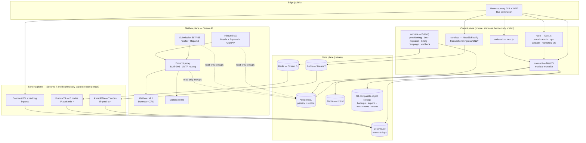
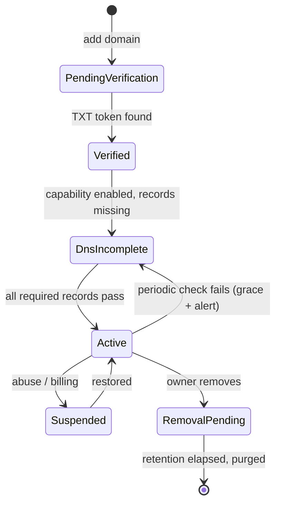
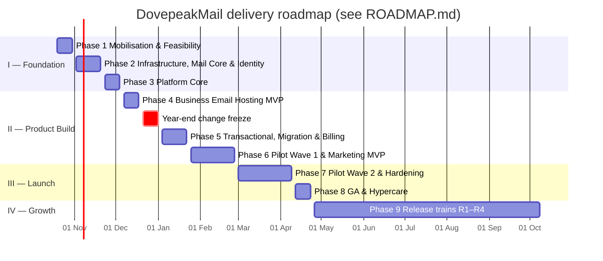

# DovepeakMail — End-to-End Implementation Plan

**Owner:** Dovepeak Technologies · **Version:** 1.0 · **Date:** 13 October 2026
**Builds on:** [product-specification.md](product-specification.md) (v0.1) — this plan turns that specification into an executable engineering programme. Where the spec says "evaluate", this plan makes a recommendation and records the alternative so the decision can be revisited.

---

## 0. How to read this document

| Section | Read it if you are… |
|---|---|
| 1–4 | Everyone. Principles, architecture, and the stream-isolation design that the whole platform depends on. |
| 5–7 | Engineers. Repo layout, service catalogue, data model. |
| 8–10 | Module owners. Detailed build plan per product and shared platform module. |
| 11–14 | SRE / security / QA. Infrastructure, security, observability, testing. |
| 15–19 | Leadership / PM. Roadmap, team, launch gates, risks, decisions, first sprint. |

---

## 1. Product shape and guiding principles

DovepeakMail is **one account, three products, one platform**:

| Product | What the customer gets | Traffic stream |
|---|---|---|
| **Business Email Hosting** | Domain mailboxes, users, groups, aliases, webmail, IMAP/SMTP, migration, storage | **Stream M** (mailbox, person-to-person) |
| **Transactional Email & Developer API** | REST API, SMTP relay, API keys, templates, webhooks, delivery logs | **Stream T** (transactional, critical) |
| **Bulk & Marketing Email** | Contacts, lists, segments, campaigns, templates, scheduling, analytics | **Stream B** (bulk / marketing) |

**Shared across all three:** account & identity, organisation/team & roles, domain management, billing & invoicing, usage metering, suppression data, audit log, support, operations console, observability.

**Separated per stream:** ingress endpoints, credentials, queues, worker pools, MTA nodes, IP pools, HELO/PTR hostnames, bounce (return-path) domains, DKIM selectors, rate limits, quotas, reputation scores, circuit breakers, and abuse thresholds.

### Guiding principles (non-negotiable)

1. **Isolation is an invariant, not a setting.** No code path lets a Stream B message leave through Stream T or M infrastructure. This is enforced in code, in configuration, and by an automated test (§13.3).
2. **Don't write SMTP/IMAP.** Use mature MTAs and mail stores; the value we build is the control plane, sending orchestration, UX and operations.
3. **The control plane never shells into mail servers.** Mail servers read narrowly-scoped config from the database or accept a small set of allow-listed API calls (§6.3).
4. **Message content stays out of the business database.** Postgres holds metadata; mail stores hold mail; ClickHouse holds events.
5. **Every tenant-scoped query is tenant-scoped by construction** (row-level security plus repository guards), not by developer discipline.
6. **Deliverability and recovery are launch gates.** A feature isn't done until it's observable, rate-limited, abuse-safe and restorable.
7. **Thresholds are configuration.** Every limit (rates, bounce/complaint thresholds, quotas) lives in a policy table that ops can tune without a deploy, starting from the defaults in §4.6.

---

## 2. System architecture overview

### 2.1 Planes



### 2.2 Message flows (one line each)

- **Inbound to a mailbox:** Internet → MX (Postfix) → Rspamd (spam, virus, SPF/DKIM/DMARC/ARC) → Dovecot proxy (LMTP) → user's mailbox cell.
- **Mailbox user sends:** client/webmail → submission (Postfix, authenticated) → Rspamd outbound scan + per-user/tenant rate limit → DKIM sign (selector `dpm`) → Stream M egress IPs → Internet.
- **App sends transactional:** app → `send-api` (REST) *or* KumoMTA T-listener (SMTP AUTH) → validate key, domain, quota, suppression → Redis-T → T dispatcher → KumoMTA T nodes → DKIM sign (selector `dpt`) → `tx-*` IP pool → Internet.
- **Campaign:** user schedules → campaign worker materialises audience, filters suppression → **paced** release into Redis-B → B dispatcher → KumoMTA B nodes → DKIM (selector `dpb`) → `mkt-*` IP pool → Internet.
- **Feedback:** bounces (VERP to `bounces-t.` / `bounces-b.` domains), FBL/ARF complaints, MTA logs, open pixel and click redirects → event ingestor → ClickHouse + suppression service + webhook dispatcher + reputation engine.

---

## 3. Key architecture decisions (ADR summary)

Each row becomes a full ADR in `docs/adr/` during Phase 1 (Mobilisation and Feasibility). "Revisit trigger" says when to reopen the decision.

| # | Decision | Recommendation | Alternative(s) considered | Revisit trigger |
|---|---|---|---|---|
| ADR-01 | Repo structure | **Monorepo** (pnpm workspaces + Turborepo), TypeScript end-to-end for app code | Polyrepo | > 4 independent teams |
| ADR-02 | Frontend | **Next.js (App Router) + TypeScript + Tailwind + shadcn/ui (Radix)**, brand tokens from guidelines | Remix, SPA + Vite | — |
| ADR-03 | Backend | **NestJS modular monolith** (`core-api`) + separately deployed **`send-api`** from the same codebase | Microservices from day 1 | A module needs independent scaling beyond `send-api` |
| ADR-04 | Primary DB | **PostgreSQL 16+** with row-level security for tenant isolation; Prisma *or* Drizzle as ORM (choose one in Phase 1 — recommend **Drizzle** for RLS/SQL control) | MySQL | — |
| ADR-05 | Jobs / queues | **BullMQ on Redis**, with **three separate Redis deployments** (control, Stream T, Stream B) | Kafka/Redpanda, NATS JetStream | Sustained > 2–3k msgs/s per stream or ordering/replay needs → introduce Redpanda for events |
| ADR-06 | Event/analytics store | **ClickHouse** for delivery events, opens/clicks, API logs, metering raw data | Postgres partitioned tables | — (avoids a painful migration later) |
| ADR-07 | Mailbox MTA/filtering | **Postfix + Rspamd + ClamAV** (as spec) | Stalwart (all-in-one, Rust; AGPL/commercial licence) | Dovecot HA limits become blocking (see ADR-08) |
| ADR-08 | Mailbox store | **Dovecot CE** in a **cell architecture**: tenants sharded across cells, Dovecot proxy routes users to their cell, ZFS on each cell with snapshot replication to a warm standby | Dovecot Pro (commercial, object storage), Stalwart cluster | > ~5k mailboxes per cell or RPO < 5 min required |
| ADR-09 | Sending MTA (T and B) | **KumoMTA** (Apache-2.0, built for high-volume senders: egress pools, per-tenant queues, traffic shaping, Lua policy, log hooks) | Postfix multi-instance, PowerMTA (commercial), Haraka | — |
| ADR-10 | Webmail | **Phase 4: branded Roundcube behind SSO for internal use and pilots. Phase 9 (release trains R2–R4): native DovepeakMail webmail** (Next.js on a `mail-gateway` IMAP/SMTP service) | SnappyMail; native from day 1 | Pilot feedback on UX |
| ADR-11 | Identity | Own auth module in `core-api` (Argon2id, TOTP + WebAuthn/passkeys) **plus an embedded OIDC provider** (`node-oidc-provider`) so webmail, Dovecot (XOAUTH2/OAUTHBEARER) and the ops console share SSO | Keycloak, Zitadel | Enterprise SSO (SAML) demand |
| ADR-12 | Deployment | **Stateless apps on Kubernetes (k3s)**; **mail nodes as VMs** managed by **Ansible**; infrastructure by **Terraform/OpenTofu**. Pilot can run apps on Docker Compose | Everything in K8s | — |
| ADR-13 | Secrets & keys | **OpenBao/Vault** (or SOPS+age for the pilot); DKIM private keys envelope-encrypted with a KMS key | Plain env files | — |
| ADR-14 | Observability | **Prometheus + Alertmanager + Grafana + Loki + OpenTelemetry (Tempo)** | Hosted APM | — |
| ADR-15 | Payments | **Manual invoice + M-Pesa (Daraja STK Push / Paybill) first; cards via Paystack or Pesapal**; **KRA eTIMS** integration for invoices | Stripe (limited KES support) | — |
| ADR-16 | Public API contract | **OpenAPI 3.1 first**; SDKs generated + hand-polished; webhooks follow the **Standard Webhooks** signature scheme | Hand-written SDKs | — |

> **Verify in Phase 1:** Dovecot CE 2.4 no longer ships the old director and dsync-replicator. That's why ADR-08 gets HA from proxy + storage-level replication. Confirm current CE capabilities and licence terms before committing. Do the same licence check for Roundcube (GPL), KumoMTA (Apache-2.0), Rspamd (Apache-2.0) and ClamAV (GPL).

---

## 4. Stream isolation and reputation design (the critical requirement)

The requirement: *a marketing campaign must never compromise password resets or ordinary business correspondence.* Isolation is applied at **eight layers**, so no single misconfiguration breaks it.

### 4.1 Isolation matrix

| Layer | Stream M (mailbox) | Stream T (transactional) | Stream B (bulk/marketing) |
|---|---|---|---|
| 1. Ingress | SMTP submission `smtp.dovepeakmail.com:587/465`, webmail | `api.dovepeakmail.com/v1/emails` (`send-api`), `smtp-relay.dovepeakmail.com:587` | Portal/campaign API in `core-api` only (no direct SMTP in MVP) |
| 2. Credentials | Mailbox password / app passwords / OIDC | API keys `dpm_live_…`, SMTP creds — **scope `transactional`** | Campaign permissions (role-based); marketing API keys **scope `marketing`** (later) |
| 3. Queues | Postfix queue on submission nodes | **Redis-T** (dedicated instance) → BullMQ `tx.high`, `tx.normal` | **Redis-B** (dedicated instance) → BullMQ `mkt.release` |
| 4. Workers | — | T dispatchers (own deployment, own HPA, guaranteed CPU) | B dispatchers + campaign workers (own deployment, preemptible) |
| 5. MTA nodes | Postfix outbound on M nodes | KumoMTA **T node group** | KumoMTA **B node group** |
| 6. IPs / PTR / HELO | `out-m{n}.dovepeakmail.com` | `out-t{n}.dpmsend.com` | `out-b{n}.dpmsend.com` |
| 7. Domain auth | DKIM selector `dpm`; envelope = customer domain | DKIM `dpt`; return-path `bounces-t.<customer>` → CNAME | DKIM `dpb`; return-path `bounces-b.<customer>` → CNAME; **recommended marketing subdomain** (e.g. `news.company.co.ke`) |
| 8. Policy & reputation | Per-mailbox + per-tenant hourly/daily caps; outbound spam scan; compromised-account auto-hold | Per-key + per-tenant rate & quota; **never paused by B metrics** | Per-tenant warm-up quota, per-campaign throttle, automatic circuit breakers |

**Sending domain choice:** use a separate domain such as `dpmsend.com` for sending-infrastructure hostnames and tracking/bounce endpoints, so the brand domain `dovepeakmail.com` (portal, MX, our own corporate mail) is never put at reputational risk by customer bulk sending.

### 4.2 IP pool topology

```
Stream M:  pool "mbx"            → 2+ IPs (shared by all hosted mailboxes)
Stream T:  pool "tx-trusted"     → 2+ IPs  (established tenants, good history)
           pool "tx-new"         → 1+ IP   (new tenants, first 30 days / volume ramp)
           pool "tx-dedicated-*" → paid add-on
Stream B:  pool "mkt-trusted"    → 2+ IPs
           pool "mkt-new"        → 1+ IP   (ramping tenants)
           pool "mkt-probation"  → 1 IP    (tenants with elevated bounces/complaints — contained)
           pool "mkt-dedicated-*"→ paid add-on (requires min. volume to stay warm)
```

- **Pilot minimum:** 3 clean IPv4s (mbx, tx, mkt) + 1 spare. **GA minimum:** ~8.
- For long-term infrastructure ownership, plan to acquire or lease a **dedicated IP block** (via AFRINIC, an LIR or an IP lease broker). That keeps IP reputation portable across hosting providers.
- **Tenant pool assignment** is a row in `tenant_pool_assignment(stream, pool)` changed by the reputation engine or ops. KumoMTA reads it through a cached HTTP policy lookup.

### 4.3 Queueing and pacing model

- **Stream T is push:** an accepted request is persisted and enqueued immediately. Target: p95 **accept → first SMTP attempt < 5 s**.
- **Stream B is pull/paced:** a campaign's audience is materialised into `campaign_recipients` (Postgres, partitioned) and released in **batches** into Redis-B by a pacer. The pacer computes `min(tenant warm-up allowance, campaign throttle, pool capacity, destination-domain shaping headroom)`. Large backlogs therefore sit in cheap storage rather than in MTA queues, so pausing or killing a campaign takes effect immediately.
- KumoMTA queues are keyed `tenant:campaign@destination-domain` (B) and `tenant@destination-domain` (T). Ops can suspend a single tenant's or campaign's queue without touching others.
- **Destination-domain shaping** (Gmail, Outlook, Yahoo, local ISPs like Safaricom-hosted domains) uses KumoMTA's shaping rules plus automation that reacts to 4xx deferrals (back off on 421/451 patterns).

### 4.4 Suppression semantics (shared data, stream-aware rules)

| Event | Stream B effect | Stream T effect | Stream M effect |
|---|---|---|---|
| Hard bounce (5.1.1 user unknown) | Suppress address (account-wide) | Suppress address (account-wide), surfaced in logs/webhook | none (normal NDR to sender) |
| Spam complaint from a **marketing** message | Suppress for marketing (account-wide) | **No effect**: password resets must still deliver | none |
| Spam complaint from a **transactional** message | Suppress for marketing | Flag; tenant reputation signal; no auto-suppress for categories marked `critical` (OTP/reset) | none |
| Unsubscribe | Suppress per **topic/list** or global marketing | **No effect** (transactional is not marketing). Spec §6.9: transactional must not be used to dodge consent; enforced by content review and abuse rules | none |
| Manual suppression | As configured (stream + scope) | As configured | — |

Suppressions are stored per **account** (not per list), with `scope ∈ {global, stream:T, stream:B, topic:<id>}`, `reason` and `source_event_id`.

### 4.5 Reputation engine

A worker computes rolling metrics per **(tenant, stream)** and per **(pool)** from ClickHouse every 5 minutes:

- hard-bounce rate, complaint rate (FBL plus Google Postmaster aggregates), unsubscribe rate, deferral rate, unknown-user rate on list imports, spam-trap hits (when trap data is available), blocklist listings (Spamhaus, Barracuda, SpamCop, …) on pool IPs and on customer link domains.

Outputs: a **tenant reputation score per stream**, automatic **pool moves** (trusted ↔ new ↔ probation), **warm-up allowance** updates, and **circuit-breaker** actions.

### 4.6 Circuit breakers (starting defaults, tuned from pilot data)

| Signal (per tenant, Stream B) | Warn | Auto-pause campaign | Auto-suspend B sending (ops review) |
|---|---|---|---|
| Hard bounce rate (per campaign, after 1k sends) | 2 % | 5 % | 10 % |
| Complaint rate | 0.08 % | 0.2 % | 0.3 % (Gmail's published bulk-sender ceiling) |
| Unknown-user rate in an imported list | 3 % | block import step until review | — |
| Deferral rate at a major provider | 10 % | throttle ×0.5 automatically | — |

Stream T has its own (looser on volume, stricter on abuse) table. Stream M uses Rspamd outbound scores plus rate anomalies, with **auto-hold** of the mailbox's outbound queue and forced password reset when compromise is suspected. **No breaker in one stream reads or acts on another stream's queues.**

### 4.7 Mailbox providers' bulk-sender requirements (baked into Stream B)

As enforced by Gmail and Yahoo since 2024 and Microsoft since 2025 for bulk senders: SPF **and** DKIM **and** DMARC (at least `p=none`) with alignment; **RFC 8058 one-click `List-Unsubscribe-Post`** on every marketing message; complaint rate kept below 0.3 %; valid forward/reverse DNS; TLS. A campaign **cannot be scheduled** until the sending domain passes all of these checks.

---

## 5. Repository and codebase structure

```
dovepeakmail/
├─ apps/
│  ├─ web/                 # Next.js: marketing site, customer portal, org admin console, ops console (role-gated route groups)
│  ├─ webmail/             # Next.js: native webmail (Phase 9); Phases 4–8 use Roundcube container from infra/
│  ├─ core-api/            # NestJS modular monolith (all control-plane modules)
│  ├─ send-api/            # NestJS+Fastify: transactional ingress only (thin; imports domain libs)
│  ├─ workers/             # BullMQ processors, one entrypoint per worker group (selected by env)
│  └─ mail-gateway/        # (Phase 9) IMAP/SMTP bridge for native webmail (imapflow + nodemailer)
├─ packages/
│  ├─ db/                  # Drizzle schema, migrations, RLS policies, seeders
│  ├─ domain/              # Pure domain logic: policies, quotas, suppression rules, pricing/rating
│  ├─ contracts/           # OpenAPI spec, zod schemas, generated types
│  ├─ email-render/        # Template engine (MJML + Handlebars/Liquid), sanitisation, link/pixel rewriting
│  ├─ dns-tools/           # DNS record generation & validation (SPF flattening checks, DKIM, DMARC parsing)
│  ├─ ui/                  # Design system: brand tokens, shadcn components, charts
│  ├─ sdk-node/            # Public SDKs (generated + wrappers); python/php/go in separate repos later
│  ├─ config/              # eslint, tsconfig, prettier presets
│  └─ testing/             # Test factories, tenant-isolation harness, mail-flow helpers
├─ infra/
│  ├─ terraform/           # Networks, VMs, DNS zones, object storage, IPs/PTR
│  ├─ ansible/             # Roles: postfix, dovecot, rspamd, clamav, kumomta, zfs, node-exporter, hardening
│  ├─ k8s/                 # Helm charts / Kustomize overlays (dev, staging, prod)
│  ├─ compose/             # Local dev + pilot Docker Compose (incl. Mailpit, Roundcube)
│  └─ kumomta/             # Lua policy, shaping files, pool definitions (templated)
├─ docs/
│  ├─ adr/                 # Architecture decision records
│  ├─ runbooks/            # Incident, abuse, restore, IP blocklisting, compromised mailbox…
│  ├─ api/                 # Public developer docs (Mintlify/Docusaurus source)
│  └─ policies/            # AUP, privacy, DPA, retention, support-access policy drafts
└─ .github/workflows/      # CI/CD
```

**Code conventions:** strict TypeScript; zod at every boundary; domain logic in `packages/domain` (framework-free, unit-tested); every `core-api` module exposes a service interface, and modules may only call each other through those interfaces (lint-enforced). This keeps the extraction path to separate services open.

---

## 6. Service catalogue

### 6.1 `core-api` modules (NestJS)

| Module | Responsibility |
|---|---|
| `identity` | Users, sessions, passwords (Argon2id), MFA (TOTP, WebAuthn), app passwords, OIDC provider, login alerts, brute-force protection |
| `accounts` | Account (= tenant/organisation), memberships, roles, invitations, ownership transfer, account status lifecycle |
| `domains` | Domain claim and verification, capability enablement (M/T/B), DNS record generation, DNS checks, DKIM keys, tracking domains |
| `hosting` | Mailboxes, aliases, distribution groups, quotas, offboarding, CSV bulk ops, provisioning jobs |
| `migration` | IMAP migration projects, accounts, jobs, reports |
| `transactional` | Projects/environments, API keys, SMTP credentials, templates (T), message log queries, webhooks config |
| `marketing` | Contacts, custom fields, consent records, lists, segments, topics/preference centre, templates (B), campaigns, reports |
| `sending-policy` | Pools, pool assignments, quotas, warm-up schedules, circuit breakers, reputation scores (read) |
| `suppression` | Account suppression list, import/export, checks API (internal, hot path cached) |
| `billing` | Products, plans, prices, subscriptions per product, usage rating, invoices, payments, M-Pesa/cards, credit notes, dunning, eTIMS |
| `notifications` | System email (dogfooding Stream T), in-app notifications, SMS for MFA fallback (optional) |
| `support` | Tickets, support-access grants (time-boxed, consented), knowledge-base links |
| `abuse` | Abuse reports intake (abuse@, ARF, form), cases, evidence, decisions, appeals |
| `ops` | Tenant search, impersonation-free diagnostics, node health, queue views, suspensions, platform settings |
| `audit` | Append-only audit events (all modules publish here) |

### 6.2 Workers (BullMQ groups, separately deployable)

| Worker group | Queues | Redis |
|---|---|---|
| `provisioning` | `prov.mailbox`, `prov.domain`, `prov.dkim` | control |
| `dns` | `dns.verify`, `dns.recheck` (scheduled, backoff) | control |
| `migration` | `mig.validate`, `mig.sync`, `mig.final` (concurrency-limited per source host) | control |
| `billing` | `bill.rate`, `bill.invoice`, `bill.dunning`, `bill.payment-webhook`, `bill.etims` | control |
| `tx-dispatch` | `tx.high`, `tx.normal` (render → sign-ready → inject into KumoMTA T) | **Redis-T** |
| `campaign` | `mkt.materialise`, `mkt.pace`, `mkt.release` | **Redis-B** |
| `events` | `evt.ingest`, `evt.suppress`, `evt.reputation` | control |
| `webhooks` | `wh.deliver.t`, `wh.deliver.b` (separate queues so a slow marketing endpoint can't delay T webhooks) | T / B respectively |
| `imports` | `contacts.import`, `contacts.verify` | Redis-B |

### 6.3 Mail-node integration (no shell access from apps)

- **Postfix lookups** (`virtual_mailbox_domains`, `virtual_mailbox_maps`, `virtual_alias_maps`, sender-login maps) via `pgsql:` against **read-only views** in a `mailcfg` schema, accessed by a DB role that can only `SELECT` those views. Each mail site gets a local Postgres **read replica**, and Postfix uses `proxymap` caching so mail keeps flowing if the primary is unreachable.
- **Dovecot** `passdb`/`userdb` via SQL views (bcrypt/Argon2 hashes, app passwords) and **OAUTHBEARER/XOAUTH2** against our OIDC provider for webmail SSO. Userdb returns the `host` of the user's cell, which the proxy uses for routing.
- **Mutations that need the mail store** (create quota root, rename, purge on deletion, recalc quota, move a user between cells) go through the **doveadm HTTP API** on the private network, using a per-cell API key. The provisioning worker is the only caller, and every call is audited.
- **KumoMTA** asks `core-api` (internal endpoint, cached 30–60 s) for: SMTP-credential auth, tenant → pool, DKIM key reference, and suspension flags. Its log hook posts batches to the `events` ingestor.

---

## 7. Data model

### 7.1 Core ERD (control plane, Postgres)

```mermaid
erDiagram
  ACCOUNT ||--o{ MEMBERSHIP : has
  USER ||--o{ MEMBERSHIP : has
  ACCOUNT ||--o{ DOMAIN : owns
  ACCOUNT ||--o{ PRODUCT_SUBSCRIPTION : subscribes
  DOMAIN ||--o{ DOMAIN_CAPABILITY : enables
  DOMAIN ||--o{ DNS_CHECK : checked_by
  DOMAIN ||--o{ DKIM_KEY : signs_with
  DOMAIN ||--o{ MAILBOX : hosts
  DOMAIN ||--o{ ALIAS : hosts
  DOMAIN ||--o{ MAIL_GROUP : hosts
  MAILBOX }o--|| MAIL_CELL : stored_on
  ACCOUNT ||--o{ PROJECT : has
  PROJECT ||--o{ API_KEY : issues
  PROJECT ||--o{ SMTP_CREDENTIAL : issues
  PROJECT ||--o{ TEMPLATE : owns
  PROJECT ||--o{ WEBHOOK_ENDPOINT : notifies
  ACCOUNT ||--o{ CONTACT : owns
  CONTACT ||--o{ CONSENT_RECORD : proves
  ACCOUNT ||--o{ LIST : owns
  LIST ||--o{ LIST_MEMBER : contains
  ACCOUNT ||--o{ SEGMENT : defines
  ACCOUNT ||--o{ CAMPAIGN : runs
  CAMPAIGN ||--o{ CAMPAIGN_RECIPIENT : targets
  ACCOUNT ||--o{ SUPPRESSION : maintains
  ACCOUNT ||--o{ TENANT_POOL_ASSIGNMENT : assigned
  IP_POOL ||--o{ TENANT_POOL_ASSIGNMENT : serves
  IP_POOL ||--o{ SENDING_IP : contains
  ACCOUNT ||--o{ INVOICE : billed
  ACCOUNT ||--o{ AUDIT_EVENT : records
  ACCOUNT ||--o{ ABUSE_CASE : subject_of
```



### 7.2 Key tables (beyond spec §9)

| Table | Notable columns / rules |
|---|---|
| `accounts` | `id`, `name`, `status (active, grace, restricted, suspended, closing, closed)`, `country`, `currency`, `tax_id`, `kyc_level`, `timezone` |
| `domains` | `account_id`, `fqdn` (unique among **active** claims), `verification_token_hash`, `verified_at`, `status` (spec §6.2 lifecycle) |
| `domain_capabilities` | `domain_id`, `capability ∈ {mailbox, transactional, marketing}`, `status (pending_dns, active, degraded, suspended)`, `required_records jsonb`, `last_checked_at` |
| `dkim_keys` | `domain_id`, `stream`, `selector`, `public_key`, `private_key_ciphertext`, `kms_key_id`, `status (pending, active, rotating, retired)` |
| `tracking_domains` | `domain_id`, `hostname` (e.g. `links.company.co.ke`), `cname_target`, `tls_status` |
| `mailboxes` | `domain_id`, `local_part`, `user_id`, `cell_id`, `quota_bytes`, `used_bytes` (synced), `status`, `send_limit_policy_id`, `deleted_at` (soft) + `purge_after` |
| `aliases` / `mail_groups` / `mail_group_members` | `posting_policy (anyone, members, domain, moderators)`, `moderators[]` |
| `projects` | transactional workspace; `environment ∈ {test, live}`. **Test keys never leave the sandbox**: they are delivered to a capture store visible in the UI |
| `api_keys` | `prefix` (shown), `hash` (SHA-256 with server pepper), `scopes[]`, `allowed_ips[]`, `allowed_domains[]`, `last_used_at`, `expires_at`, `revoked_at` |
| `templates` / `template_versions` | `stream`, `engine (mjml+handlebars)`, `subject`, `html`, `text`, `variables_schema jsonb`, `published_version` |
| `contacts` | `account_id`, `email` (normalised, unique per account), `attributes jsonb`, `status`, `source`, `created_via` |
| `consent_records` | `contact_id`, `topic_id`, `basis (consent, contract, legitimate_interest)`, `source`, `captured_at`, `ip`, `evidence_ref` |
| `campaigns` | `status (draft, scheduled, sending, paused, completed, cancelled, killed)`, `audience_def jsonb`, `send_at`, `timezone_mode`, `throttle_per_hour`, `topic_id` |
| `campaign_recipients` | **partitioned by campaign**; `contact_id`, `state (pending, released, accepted, delivered, bounced, suppressed_skip…)` |
| `suppressions` | `account_id`, `email_hash` + `email`, `scope`, `reason`, `source_event_id`, `created_at`, `expires_at` (soft bounces) |
| `ip_pools` / `sending_ips` / `tenant_pool_assignment` | `stream`, `tier`, `ip`, `ptr`, `warmup_stage`, `blocklist_status` |
| `policies` | `scope (platform, plan, account, mailbox, key)`, `key`, `value`, `effective_from`. All tunable limits live here |
| `product_subscriptions` | `account_id`, `product ∈ {hosting, transactional, marketing}`, `plan_id`, `status`, `period_start/end`, `quantity` (seats) |
| `usage_records` | rated daily aggregates from ClickHouse: `product`, `metric`, `quantity`, `period` |
| `invoices` / `invoice_lines` / `payments` | multi-product lines on one invoice; `etims_status`, `mpesa_receipt` |
| `audit_events` | append-only (no UPDATE/DELETE grant); hash-chained per account for tamper evidence |

### 7.3 ClickHouse (events)

- `message_events` (`ts`, `account_id`, `stream`, `project_id`, `campaign_id`, `message_id`, `recipient_hash`, `recipient_domain`, `event` — queued, sent, delivered, deferred, bounced, complained, opened, clicked, unsubscribed, rejected —, `smtp_code`, `enhanced_code`, `pool`, `ip`, `mx_host`, `url_id`, `ua_class`, `is_machine_open`). TTL: 13 months raw; aggregates kept longer.
- `api_requests` (`ts`, `request_id`, `key_prefix`, `endpoint`, `status`, `latency_ms`, `idempotency_key`).
- Materialised views for per-campaign, per-tenant-stream, per-pool and per-destination-domain rollups, which feed dashboards and the reputation engine.

### 7.4 Tenant isolation implementation

- Every tenant table has `account_id`. Postgres **RLS policies** use `current_setting('app.account_id')`, set per transaction by a NestJS interceptor from the authenticated principal.
- The ops console uses a separate DB role with `BYPASSRLS`, **only** inside the `ops` module and only with an audited justification.
- The isolation test harness (§13.2) runs every tenant-scoped endpoint with a foreign tenant's IDs and expects `404`.

---

## 8. Unified domain management

One domain, added once, can enable any combination of the three capabilities. The UI shows **one domain page with three capability cards**, each with its own DNS checklist and status.

### 8.1 Lifecycle



### 8.2 Records generated per capability (example for `company.co.ke`)

| Purpose | Record | Value pattern |
|---|---|---|
| Ownership | `TXT _dovepeak-verify.company.co.ke` | `dpm-verify=<token>` |
| Mailbox: MX | `MX company.co.ke` | `10 mx1.dovepeakmail.com.`, `20 mx2.dovepeakmail.com.` |
| Mailbox: SPF | `TXT company.co.ke` | `v=spf1 include:_spf.dovepeakmail.com ~all` (we **merge** with existing SPF and warn on > 10 DNS lookups) |
| Mailbox: DKIM | `CNAME dpm._domainkey` | `dpm.company-co-ke.dkim.dovepeakmail.com` (CNAME → we can rotate keys without customer action) |
| T: DKIM | `CNAME dpt._domainkey` | `dpt.<slug>.dkim.dpmsend.com` |
| T: Return-path | `CNAME bounces-t` | `t.bounce.dpmsend.com` (gives SPF alignment for T) |
| B: DKIM | `CNAME dpb._domainkey` (on the marketing subdomain if used) | `dpb.<slug>.dkim.dpmsend.com` |
| B: Return-path | `CNAME bounces-b` | `b.bounce.dpmsend.com` |
| B: Tracking | `CNAME links` | `track.dpmsend.com` (we issue TLS via ACME automatically) |
| DMARC | `TXT _dmarc` | Start with `v=DMARC1; p=none; rua=mailto:<id>@dmarc.dovepeakmail.com`; the UI guides moving to `quarantine`/`reject` |
| Optional | MTA-STS (`_mta-sts` TXT + hosted policy), TLS-RPT, BIMI (later) | hosted by us at `mta-sts.<domain>` via CNAME |

### 8.3 DNS checker

- Queries **authoritative nameservers directly** (not caching resolvers) using a pinned resolver library, and records observed vs expected values per record in `dns_checks`.
- Diagnoses: conflicting MX, multiple SPF records, SPF lookup count, missing/mismatched DKIM, DMARC syntax, CNAME-at-apex conflicts, Cloudflare-proxied records, propagation lag.
- Schedule: every 2 minutes for the first hour after a change, then hourly, then daily for active domains. A failure on an Active domain → 24 h grace → customer notification → capability `degraded`.
- **One-click setup:** support the **Domain Connect** protocol for registrars that implement it; provide copy-paste blocks plus provider-specific guides (Kenyan registrars, Cloudflare, cPanel hosts).
- **Later (Phase 9, release train R4):** optional DovepeakDNS (authoritative, e.g. PowerDNS) for customers who delegate nameservers. Records are then auto-managed.

### 8.4 DMARC reporting

Ingest aggregate (`rua`) reports at `dmarc.dovepeakmail.com` and parse them into ClickHouse. Show customers which sources send as their domain, so they can safely move to enforcement. This is a strong differentiator for SMEs.

---

## 9. Shared platform modules — build plan

### 9.1 Identity, accounts and access

**Build:**
- Sign-up with email verification; sign-in with password + optional TOTP/passkeys; **MFA mandatory for Owner/Admin/Billing roles and all Dovepeak staff**.
- Sessions: httpOnly secure cookies, server-side session store (Postgres + Redis cache), device list, revoke-all.
- Roles (account-scoped): `owner`, `admin`, `billing_admin`, `helpdesk` (read-only + reset passwords), `developer` (Transactional only), `marketer` (Marketing only), `analyst` (read-only reports), `mailbox_user`. Permissions are fine-grained (`hosting.mailbox.create`, `marketing.campaign.send`, …) and roles are bundles of them, so custom roles can come later without a rewrite.
- Invitations, ownership transfer (with re-auth + email confirmation to both parties), account recovery with a cooling-off period.
- **A mailbox user is a user**: creating a mailbox creates or links a `user` with role `mailbox_user`, so the same identity signs into webmail and (if granted) the portal.
- App passwords for IMAP/SMTP clients when MFA is on; OAuth2 for clients that support it (Thunderbird, iOS Mail via the profile).
- Login protections: rate limiting per IP + per account, breached-password check (k-anonymity HIBP API), suspicious-login alerts.

**Exit criteria:** isolation suite green; MFA enforcement tested; audit events for every auth-sensitive action.

### 9.2 Billing, metering and plans

**Model:** one account → one billing profile → one invoice per period, with **line items per product**.

| Product | Billing unit (initial hypothesis) |
|---|---|
| Hosting | Per mailbox per month by tier (Starter / Business / Business Plus, per spec §13); extra storage packs |
| Transactional | Free tier (e.g. 3,000 emails/month, 100/day), then volume tiers (e.g. 50k, 100k, 250k/month) + overage per 1,000; dedicated IP add-on |
| Marketing | By **contacts stored** tier (e.g. 1k, 5k, 10k, 25k) with a send cap of ~10–12× contacts per month; or a pay-as-you-go credits pack |
| Services | Assisted migration, onboarding, priority support |

**Build:**
1. Catalogue: `products`, `plans`, `prices` (KES + USD, monthly/annual), `entitlements` (machine-readable limits that feed `policies`).
2. Metering: ClickHouse → nightly + hourly `usage_records` (accepted messages per stream, contacts stored, storage GB-days, dedicated IPs).
3. Rating and invoicing: proration for seat changes, annual prepay, tax (**16 % VAT**, configurable), credit notes.
4. Payments, in order: (a) manual invoice + bank/M-Pesa Paybill reconciliation in the ops console; (b) **M-Pesa STK Push** via Daraja with callback verification and idempotent reconciliation; (c) cards via Paystack/Pesapal; (d) prepaid wallet / credits for Transactional & Marketing PAYG.
5. **KRA eTIMS** invoice transmission (via an approved integrator or direct OSCU/VSCU integration — confirm with tax adviser).
6. Dunning: invoice due → reminders → **grace (e.g. 14 days)** → **restricted** (no new mailboxes/campaigns; Stream B paused; Stream T and mailboxes keep working) → **suspended** (mail still received and stored; login limited to billing/export) → after a long, documented period, deletion with prior notices. **Mail is never deleted on payment failure without the documented retention window** (spec §6.7).
7. Hard enforcement points: mailbox create checks seat entitlement; T quota checks at `send-api`; B audience size checked at schedule time against the contact tier.

### 9.3 Notifications and dogfooding

All DovepeakMail system email (verification, invoices, alerts) is sent **through our own Stream T** from a dedicated internal project. This proves the platform early, and the T pool warms up with legitimate traffic.

### 9.4 Audit log

Append-only, written via an outbox in the same transaction as the change. Visible to account admins (their account) and ops (all). Exportable as CSV/JSON. Retained ≥ 1 year (policy).

### 9.5 Support and support access

- In-portal tickets (initially backed by our own tables; integrate a helpdesk later if needed), status page (`status.dovepeakmail.com`, self-hosted, e.g. Upptime/cState, hosted **outside** the main infrastructure).
- **Support access to mailbox content requires the customer's explicit, time-boxed grant** (spec persona: "without unrestricted mailbox access"). Ops tooling shows diagnostics (DNS, queue state, delivery logs, quota) without content.

---

## 10. Product modules — build plan

### 10.1 Business Email Hosting (Stream M)

**Mail infrastructure (Phase 2):**
- MX nodes: Postfix (postscreen, RBL weighting, TLS, size limits) → Rspamd (Bayes, fuzzy, DKIM/SPF/DMARC/ARC verification, ClamAV, phishing, URL reputation) → LMTP to the Dovecot proxy.
- Submission nodes: Postfix 587 (STARTTLS) + 465 (implicit TLS), SASL via Dovecot, `reject_sender_login_mismatch` (users can only send as their mailbox, aliases or groups they're permitted for), Rspamd outbound scan + `ratelimit` module keyed per user and per tenant, DKIM signing via Rspamd using keys fetched by selector.
- Dovecot: IMAP 993 (POP3 995 optional, off by default), LMTP, quota plugin, `fts` (Flatcurve/Xapian) for server-side search, Sieve/ManageSieve for filters, vacation and forwarding rules.
- Cells: each cell = 1 primary VM with ZFS (NVMe mirror) + 1 warm standby receiving `zfs send` snapshots every 5–15 min, plus nightly encrypted off-site backups (restic/borg → S3 in another region/provider).

**Control-plane features (provisioning backend Phase 3; admin, webmail and safety Phase 4):**
- Domain capability `mailbox`: enable, DNS checklist, activation.
- Mailboxes: create (single + CSV bulk with row-level results), edit, quota change, password reset, force sign-out, suspend/restore, delete (soft, then purge after N days), **offboarding wizard** (disable sign-in, revoke sessions and app passwords, convert to alias or forward to manager, optional export to S3 with an expiring link, retain per policy).
- Aliases (included per plan rules), catch-all (off by default, warning shown).
- Distribution groups with posting policy, moderation and external-sender controls.
- Per-mailbox settings visible to the admin: storage used, last login, client protocols used, MFA status, sending limit.
- Client setup page with auto-config (Thunderbird autoconfig XML, Outlook autodiscover, iOS `.mobileconfig`) and published hostnames.
- Spam controls: per-domain allow/block lists, quarantine digest (later), user "mark as spam/not spam" training through IMAP folder moves (Rspamd + Sieve).

**Later:** shared mailboxes with delegated ACLs (Dovecot ACL + shared namespaces), retention policies and legal hold, calendar/contacts (CalDAV/CardDAV, e.g. via a maintained server), resource booking.

### 10.2 Webmail

- **Phases 4–8 (internal, pilot, GA):** Roundcube container, branded with DovepeakMail colours (navy `#000027`, orange `#ff6300`, green `#2f821a`, off-white `#f8f8ff`) and fonts (Open Sans / Lato), SSO via OIDC → Dovecot OAUTHBEARER, served at `mail.dovepeakmail.com`. Plugins: managesieve, password (disabled; password changes go through the portal), markasjunk.
- **Phase 9 (native; beta in R2, GA in R4):** Next.js webmail backed by `mail-gateway` (pooled IMAP via `imapflow` with IDLE → server-sent events, SMTP submission via the user's identity). Features: threaded conversation view, fast search (Dovecot FTS), keyboard shortcuts, attachments via S3 presigned uploads, signatures, templates, snooze, undo send, rich composer with sanitised HTML, PWA for mobile, unified account switcher with the portal. Build this once usage data shows which features matter.

### 10.3 Migration

- **Model:** `migration_project` → `migration_accounts` (source host, source user, mapped destination mailbox) → jobs.
- **Engine:** an IMAP-to-IMAP sync worker built on `imapflow` (or a wrapped `imapsync` after a licence check). Folder mapping, UID-based incremental sync, per-folder counts, size, message-level errors, throttled per source host.
- **States** per spec: Draft → Validating → Queued → Running → Partial/Failed → Completed → Final sync completed.
- **Credentials:** encrypted with a dedicated KMS key, decrypted only inside the worker, deleted automatically at completion or after 14 days. Never logged (log-redaction middleware + test).
- **Cutover assistant:** checklist (lower MX TTL → full sync → switch MX → final delta sync → verify counts → decommission), CSV upload of source credentials, or (later) OAuth to Google/Microsoft.
- **Later:** Google Workspace and Microsoft 365 API migrations (mail, contacts, calendar), PST/MBOX/EML import.

### 10.4 Transactional Email & Developer API (Stream T)

**API surface (v1):**

```
POST   /v1/emails                 send one (to ≤ 50 recipients) — supports template_id + variables, attachments, tags, metadata, scheduled_at (≤ 72h)
POST   /v1/emails/batch           up to 100 messages, partial success response
GET    /v1/emails/{id}            status + event timeline
POST   /v1/emails/{id}/cancel     cancel a scheduled send
GET    /v1/events                 cursor-paginated event log (filters: tag, recipient, type, time)
CRUD   /v1/templates[/{id}/versions]
CRUD   /v1/domains                read sending-domain status (create via portal or API)
CRUD   /v1/webhooks               endpoints + event selection + secret rotation
CRUD   /v1/suppressions
GET    /v1/usage
```

- Auth: `Authorization: Bearer dpm_live_…` (or `dpm_test_…`). Scopes: `emails:send`, `emails:read`, `templates:write`, `webhooks:write`, `suppressions:write`, `domains:read`. Optional IP allowlist and sender-domain restriction per key.
- **Idempotency:** `Idempotency-Key` header, stored 24 h in Redis-T + Postgres; same key with a different payload → 409.
- **Every response carries `X-Request-Id`**; errors use RFC 9457 problem+json with stable codes.
- **Rate limits:** token bucket per key and per account (headers `RateLimit-*`); quotas from entitlements; 429 with `Retry-After`.
- **Message categories:** `critical` (OTP, password reset, security alert), `standard` (receipts, notifications). The category sets queue priority (`tx.high` vs `tx.normal`) and complaint-handling semantics (§4.4).
- **Validation at accept time:** sending domain capability `transactional=active`, `from` within the verified domain, recipient not suppressed (returns `accepted` with a `suppressed` event, so senders can see why), message size ≤ 20 MB (configurable), attachments type-checked, HTML sanitised for script injection (we sign, so we are responsible).
- **SMTP relay:** `smtp-relay.dovepeakmail.com:587/465`, username = `dpm_smtp_<id>`, password = generated secret. Handled by KumoMTA T-listener with an auth hook. Same quotas, suppression, logs and webhooks as the API.
- **Templates:** MJML + Handlebars; versioning with draft/published; required-variable schema; preview with sample data; test send; locale variants (en/sw) later.
- **Webhooks:** events `email.sent | delivered | deferred | bounced | complained | opened | clicked | rejected | suppressed`. Signed per the Standard Webhooks spec (`webhook-id`, `webhook-timestamp`, `webhook-signature` HMAC-SHA256), at-least-once delivery, exponential retry for 24 h, auto-disable after sustained failure with an email notice, replay from the UI, delivery attempt log.
- **Test mode:** `dpm_test_` keys deliver to a per-project **sandbox inbox** viewable in the portal (Mailpit-like) and never reach the Internet. This is ideal for local dev and CI.
- **SDKs** (Node and PHP in Phase 5 after the API freeze; Python and Go in Phase 9 R1): Node/TypeScript, Python, **PHP/Laravel** (high usage in Kenya), Go; later Java/.NET. Plus copy-paste snippets for cURL, Django, Express, Laravel mail driver and NestJS.
- **Developer portal:** docs site (`docs.dovepeakmail.com`) generated from OpenAPI with guides (verify a domain, send an OTP, handle webhooks, go-live checklist).
- **Portal UI:** projects, keys (show once), SMTP credentials, domains, templates, **message log with full event timeline** (headers + safe metadata; body retention configurable, default off or 72 h), webhook monitor, usage charts.

### 10.5 Bulk & Marketing Email (Stream B)

**Audience:**
- Contacts with standard + custom fields (typed), tags, per-topic subscription status, consent records (source, timestamp, IP, form/import reference).
- CSV/XLSX import wizard: column mapping, dedupe, normalisation, **mandatory consent attestation + source description**, automatic hygiene (syntax, MX existence, disposable/role-address flags, prior suppressions). If unknown-user/invalid rates are high, the import is held for review (§4.6).
- Lists (static), **segments** (dynamic: rules over fields, tags, engagement — e.g. "opened in last 90 days"), suppression always applied last.
- Signup forms (hosted page + embeddable snippet) with **double opt-in** option, honeypot + rate limit + optional CAPTCHA.
- Preference centre + one-click unsubscribe pages (hosted on the customer's tracking domain), with topics/global unsubscribe.

**Campaigns:**
- Editor: (MVP) template gallery + **block-based visual editor** (e.g. GrapesJS/Unlayer-like, MJML output) + raw HTML mode; personalisation tokens with fallbacks; preview across desktop/mobile; test send to up to 5 addresses; content checks (spam-score preview via Rspamd, broken links, missing alt text, missing physical address/sender identification, image-to-text ratio).
- Scheduling: send now, scheduled, recipient-timezone (later), throttle (per hour); pause, resume, cancel, **kill** (ops).
- Pre-send gate (blocks scheduling): domain `marketing=active` with DKIM + DMARC + aligned return-path, unsubscribe present, sender identity present, audience within plan, account not in restricted/probation-blocked state, **first-campaign review** for new accounts (ops queue, SLA e.g. 4 business hours).
- Sending: materialise → suppression filter → paced release (§4.3) → per-recipient rendering (tracking links + pixel, `List-Unsubscribe` + `List-Unsubscribe-Post` headers, VERP return-path, `Feedback-ID` header for Gmail FBL).
- Reports: sent, delivered, bounced (hard/soft), complaints, unsubscribes, opens (unique/total, **machine-open filtered** and labelled as estimates; spec §6.8), clicks (unique, per-link heatmap), by-domain breakdown, timeline; recipient-level activity (role-gated); CSV export.

**Later:** automation journeys (welcome series, triggered on events/API), A/B tests (subject/content/send-time), landing pages, advanced segmentation, predictive send time, SMS/WhatsApp channels (separate product decision).

### 10.6 Sending core (shared by T and B)

- **Renderer** (`packages/email-render`): MJML → HTML, text alternative generation, CSS inlining, link rewriting with signed tracking tokens (HMAC, no PII in the URL), pixel insertion (B by default; T opt-in per project).
- **Injector:** HTTP injection into KumoMTA (its HTTP API), carrying the metadata headers (`X-DPM-Tenant`, `X-DPM-Stream`, `X-DPM-Campaign`, `X-DPM-Msg`) that KumoMTA policy uses to select queue, pool and DKIM key. These headers are **stripped before delivery**. The KumoMTA T and B node groups **refuse** messages whose stream header doesn't match their group (defence in depth).
- **DKIM:** KumoMTA signs with per-domain keys fetched from a secret store (cached in memory, never on disk in plaintext); 2048-bit RSA (Ed25519 dual-signing later); rotation every 6–12 months via CNAME indirection.
- **Bounce processing:** VERP addresses on the per-stream bounce domains route to KumoMTA bounce listeners. Classification uses KumoMTA's bounce classifier plus our rules into `hard | soft | block | policy | quota | unknown`. Soft bounces are retried by the MTA, and after N consecutive soft failures across sends the address gets a temporary suppression.
- **Complaints / FBL:** register with Yahoo CFL, Microsoft JMRP and SNDS, Google Postmaster Tools (aggregate), and other ISP loops where available. ARF parsing goes to `complained` events.
- **Tracking service:** stateless edge (`track.dpmsend.com` + customer CNAMEs), records opens/clicks to a Redis stream → ClickHouse, redirects in < 50 ms, guards against open-redirect abuse (signed URLs only), detects bots and security scanners (pre-fetch clicks flagged).
- **Event ingestor:** dedupe by `(message_id, event, ts bucket)`; fan-out to ClickHouse, suppression updates, campaign recipient state, webhook dispatch and the reputation engine.

### 10.7 Operations console and abuse management

- **Tenant 360:** account status, plans, usage, domains + DNS state, mailboxes count, streams' reputation scores and pool assignment, recent incidents, open abuse cases, audit trail. **No mail content.**
- **Sending ops:** live queue depth per stream/pool/destination domain, deferral heatmap, top senders, IP blocklist status, warm-up progress, one-click actions (pause tenant stream, move pool, kill campaign, adjust throttle) — all requiring a reason and logged.
- **Mailbox ops:** cell health, disk/ZFS status, replication lag, quota outliers, compromised-mailbox queue (Rspamd outbound hits, rate anomalies, impossible-travel logins).
- **Abuse:** intake (abuse@ mailbox, ARF reports, web form, Spamhaus/SpamCop notices) → case with linked evidence (message IDs, headers, never full bodies unless lawfully needed) → decision (warn, restrict, suspend, terminate) → customer notification → appeal workflow.
- **Review queues:** new-account marketing review, list-import holds, first campaigns, dedicated IP requests, KYC escalations.
- **Staff access:** separate staff identities, hardware-key MFA, role-scoped (`ops_viewer`, `ops_operator`, `abuse_analyst`, `billing_ops`, `platform_admin`), break-glass procedure, all actions audited and reviewed weekly.

### 10.8 Customer portal UX (one product experience)

- **Global navigation:** *Overview · Domains · Email Hosting · Transactional · Marketing · Billing · Settings.* Products not yet subscribed show an in-place trial/activation card. This keeps one account and a seamless upsell.
- **Onboarding wizard:** "What do you want to do first?" (Get business email / Send from my app / Send newsletters) → domain step (shared) → product-specific setup → checklist on Overview.
- **Overview dashboard:** domain health, mailbox seats used, T volume and delivery rate, last campaign results, invoice status, alerts.
- **Design system:** brand tokens (navy for structure/headers, orange for primary actions, green for success, off-white canvas), Open Sans headings/UI and Lato body; WCAG 2.2 AA; dark mode; mobile-responsive admin. Logos and favicons come from [branding/](branding/).
- **Localisation:** English first; Swahili strings prepared (i18n framework from day one). Currency KES/USD; Africa/Nairobi default timezone.

---

## 11. Infrastructure and deployment

### 11.1 Provider selection criteria (Phase 1 gate, G1)

Written confirmation that: outbound port 25 is permitted (or can be unblocked) on the IPs we'll use; PTR is editable; IPs are clean (check Spamhaus, Barracuda, SORBS, Microsoft SNDS history); additional IPv4s or BYOIP are available; NVMe storage with snapshots; private networking; ≥ 2 regions/DCs; DDoS mitigation; acceptable data-protection terms (Kenya DPA cross-border transfer requirements). **Use two independent providers** (or a provider + colo) for failure-domain separation; one of them can host the off-site backups and status page.

### 11.2 Topology by stage

| Component | Internal / pilot (≤ 200 mailboxes, low volume) | GA (≤ 5k mailboxes, ~5M sends/month) | Scale |
|---|---|---|---|
| Control plane apps | 1 VM, Docker Compose | k3s cluster: 3 nodes | More nodes, separate node pool for `send-api` |
| Postgres | 1 VM + streaming replica + WAL archiving (pgBackRest → S3) | Primary + sync replica (Patroni) + async replica per mail site | Read replicas, partitioning |
| Redis ×3 | Single VM, 3 instances | 3 separate HA deployments (Sentinel) | Cluster |
| ClickHouse | 1 VM | 2 replicas (ClickHouse Keeper) | Shards |
| MX / submission | 1 VM (both roles) | 2 MX + 2 submission VMs | More, geo-distributed |
| Mailbox cells | 1 cell (primary + standby) | 2–4 cells | N cells |
| KumoMTA | 1 VM, **separate IPs for T and B** | **2 T nodes + 2 B nodes** (physically separate) | Per-pool node groups |
| Tracking/bounce ingress | On control-plane VM | 2 small VMs behind LB | CDN in front of tracking |
| Object storage | Provider S3 in other DC | Provider S3, cross-provider replication for backups | — |
| Monitoring | 1 VM (Prometheus, Grafana, Loki) | Dedicated, outside prod failure domain | — |

The spec's warning applies: the single-VM pilot is **not** a commercial production environment. GA requires the GA column.

### 11.3 Hostnames

`dovepeakmail.com` (site), `app.` (portal), `mail.` (webmail), `api.` (public API), `smtp.` (mailbox submission), `imap.`, `mx1./mx2.`, `smtp-relay.` (T SMTP), `docs.`, `status.` (external), `autoconfig.`/`autodiscover.`, `mta-sts.`; sending infrastructure on `dpmsend.com`: `out-t*`, `out-b*`, `track.`, `t.bounce.`, `b.bounce.`, `*.dkim.`.

### 11.4 IP and domain warm-up

- Weeks 1–2: Dovepeak's own mailboxes and system email only (M and T pools).
- Weeks 3–6: pilot customers. T ramps first. B starts at ~500/day per IP to engaged recipients and roughly doubles every 2–3 days while metrics stay healthy (an automated warm-up schedule in `policies`).
- Register IPs/domains with Google Postmaster Tools, Microsoft SNDS/JMRP, Yahoo CFL; publish `postmaster@` and `abuse@`; set up the DMARC `rua` for our own domains.

### 11.5 Environments and CI/CD

| Env | Purpose | Mail behaviour |
|---|---|---|
| `local` | Docker Compose: Postgres, Redis×3, ClickHouse, Mailpit, Roundcube, Postfix/Dovecot/KumoMTA test containers | All outbound captured by Mailpit |
| `dev` | Shared integration, auto-deploy on merge to `main` | Captured, no external delivery |
| `staging` | Production-like topology at small size, real DNS on a staging domain | External delivery **only to an allow-listed seed list** (Gmail/Outlook/Yahoo/local test accounts) |
| `prod` | Customers | Real |

**Pipeline (GitHub Actions):** lint → typecheck → unit → integration (Testcontainers) → tenant-isolation suite → build images (SBOM via Syft, scan via Trivy, sign via cosign) → deploy to dev → e2e (Playwright) → manual promotion to staging → mail-flow & deliverability smoke tests → manual promotion to prod (canary for `send-api`). DB migrations are expand/contract only, run as a separate job before app rollout. Mail-node config changes go through Ansible with `--check` diff in PR + staged rollout per node.

---

## 12. Security and compliance

### 12.1 Controls

- **Network:** private VPC; only the LB, MX, submission, KumoMTA listeners and tracking ingress are public; WireGuard for admin access; no SSH from the Internet; CrowdSec/fail2ban on mail ports.
- **Secrets:** OpenBao/Vault with short-lived DB credentials; KMS envelope encryption for DKIM keys, migration credentials and webhook secrets.
- **Data:** TLS everywhere (TLS 1.2+ for SMTP, opportunistic outbound + MTA-STS honoured); encrypted disks; encrypted backups (restic) with keys held separately from backup credentials; **immutable/object-lock** backup bucket.
- **App security:** OWASP ASVS L2 as target; CSP and strict headers; CSRF protection; SSRF guard on webhook URLs (block private IP ranges, re-resolve per attempt); HTML sanitisation in templates; dependency scanning; secret scanning; signed images.
- **Logging hygiene:** a central redaction layer (passwords, tokens, API keys, migration creds, message bodies never logged); tests assert redaction.
- **Staff:** least privilege, hardware-key MFA, quarterly access reviews, break-glass with dual approval.
- **Pen test** by an external party before paid launch; bug-bounty/VDP (`security.txt`) after launch.

### 12.2 Compliance workstream (with legal counsel; not legal advice)

- **Kenya Data Protection Act 2019:** register with the ODPC as data controller/processor as applicable; DPIA for marketing and mailbox processing; cross-border transfer basis if any infra is outside Kenya; data-subject request process; breach notification (72 h to ODPC) runbook.
- Customer-facing documents: Terms of Service, **Acceptable Use Policy** (no purchased/scraped lists, no transactional-as-marketing), Privacy Policy, **Data Processing Agreement**, Anti-Spam Policy, SLA statement, Support Access Policy, Retention & Deletion Policy, Sub-processor list.
- Marketing law alignment: Kenya DPA consent requirements for direct marketing; for recipients abroad, CAN-SPAM/GDPR-style expectations → product enforces sender identity, unsubscribe and consent records.
- Tax: VAT registration and **eTIMS** invoicing; digital service tax considerations for foreign customers (adviser to confirm).

### 12.3 Threat model highlights (to be completed in Phase 1)

Compromised mailbox spamming → outbound scan + rate limit + auto-hold. Stolen API key → key scopes, IP allowlist, anomaly alerts, instant revoke. Malicious marketer with a scraped list → import hygiene + first-campaign review + breakers. Phishing hosted via our tracking domain → signed redirects only + URL reputation scanning. Cross-tenant data access → RLS + isolation tests. Insider access → no content access without a customer grant; audit. Domain takeover of a dangling claim → re-verification and expiry of unverified claims. DoS on `send-api` → WAF, per-key limits, separate deployment.

---

## 13. Observability, SLOs and testing

### 13.1 SLOs (initial)

| Service | SLI | Target |
|---|---|---|
| `send-api` | Successful accept (non-4xx) availability | 99.95 % monthly |
| Stream T | Accept → first delivery attempt, p95 | < 5 s (critical), < 30 s (standard) |
| Stream T | Isolation SLO: T p95 latency during an active B backlog of ≥ 1M | unchanged within 10 % |
| Mailbox | IMAP/SMTP submission availability | 99.9 % monthly |
| Inbound mail | MX accept → mailbox delivery, p95 | < 60 s |
| Portal | Page availability | 99.9 % |
| Webhooks | Event → first webhook attempt, p95 | < 30 s |
| Backups | Control-plane RPO / RTO | ≤ 5 min / ≤ 4 h (pilot targets — confirm) |
| Mail data | RPO / RTO per cell | ≤ 15 min / ≤ 8 h (pilot targets — confirm) |

### 13.2 Alerts (minimum set, from spec §15 + additions)

Disk pressure, ZFS errors, replication lag, Postfix/KumoMTA queue growth per stream, deferral spikes per destination domain, bounce/complaint breaker triggers, blocklist listing of any IP or the sending domains, certificate expiry (< 21 d), backup job failure or stale backups, restore-drill overdue, DNS checker failure surge, `send-api` error rate/latency SLO burn, webhook backlog, Redis memory per instance, Postgres replication lag, login brute-force spikes, unusual outbound volume per mailbox.

### 13.3 Testing strategy

| Layer | What | Tooling |
|---|---|---|
| Unit | Domain logic (policies, suppression rules, rating, DNS parsing) — ≥ 90 % coverage in `packages/domain` | Vitest |
| Integration | Modules with real Postgres/Redis/ClickHouse | Testcontainers |
| **Tenant isolation** | Auto-generated test for every tenant-scoped route: foreign IDs → 404; RLS bypass attempts | Custom harness in `packages/testing` |
| Contract | OpenAPI conformance for `send-api`; SDK tests against the mock server | Schemathesis / Prism |
| Mail flow | Send/receive between test domains; SPF/DKIM/DMARC pass checks; Sieve; quota; alias/group expansion | Scripted SMTP/IMAP tests in CI against containerised mail stack |
| **Stream isolation** | Inject a 1M-recipient campaign into staging, then measure T latency SLO; kill Redis-B and verify T unaffected; mis-tagged message rejected by the wrong KumoMTA group | k6 + custom harness (blocking in the release pipeline from G6 onward) |
| Deliverability | Seed-list inbox placement to Gmail/Outlook/Yahoo/local ISPs per release and weekly; header analysis | Own seed accounts (+ optional GlockApps-type service) |
| E2E | Onboarding, domain verify (mock DNS), mailbox create, campaign send, API send | Playwright |
| Load | `send-api` 500 rps sustained, tracking 2k rps, IMAP concurrency per cell | k6, imaptest |
| Security | SAST, DAST (ZAP) on staging, dependency scans, external pen test | Semgrep, ZAP, Trivy |
| DR | Quarterly restore drills (Postgres PITR, cell failover, full mailbox restore from off-site) | Runbooks + timed drills |

---

## 14. Delivery roadmap

The authoritative, dated schedule is **[ROADMAP.md](ROADMAP.md)**. It has every phase, track, milestone (`M<phase>.<n>`) and gate (`G<phase>`), week by week. This section summarises it. The two documents use the **same phase numbers and names**.

Delivery runs as **9 strictly sequential phases in 4 stages**. Phases never overlap. Work that happens at the same time is organised as parallel **tracks** inside a phase, and each phase closes with one gate review. W1 = week of Monday 19 October 2026.

| Stage | Phase | Weeks | Dates | Scope (implementation-plan sections) | Gate |
|---|---|---|---|---|---|
| **I — Foundation** | **Phase 1 — Mobilisation and Feasibility** | W1–W2 | 19 Oct – 30 Oct 2026 | Provider/IP feasibility, deliverability spike, ADRs (§3), threat model (§12.3), ERD (§7), repo + CI (§5), cost model, wireframes | G1 |
| | **Phase 2 — Infrastructure, Mail Core and Identity** | W3–W5 | 2 Nov – 20 Nov 2026 | Infrastructure and mail planes (§2, §6.3, §11), T/B pool separation (§4), identity and accounts (§9.1), RLS (§7.4), portal shell (§10.8) | G2 |
| | **Phase 3 — Platform Core: Domains, Administration and Operations** | W6–W7 | 23 Nov – 4 Dec 2026 | Unified domains (§8), OIDC SSO, audit (§9.4), policies, ops console v1 (§10.7), billing catalogue (§9.2), provisioning backend (§10.1) | G3 |
| **II — Product Build** | **Phase 4 — Business Email Hosting MVP** | W8–W9 | 7 Dec – 18 Dec 2026 | Hosting admin, webmail and clients (§10.1–§10.2), mail safety and offboarding; Transactional API foundation (§10.4) | G4 |
| | *Year-end change freeze* | W10–W11 | 21 Dec 2026 – 1 Jan 2027 | No production changes | — |
| | **Phase 5 — Transactional Platform, Migration and Billing Core** | W12–W14 | 4 Jan – 22 Jan 2027 | Sending core (§10.6), Transactional product (§10.4), migration (§10.3), subscriptions, invoicing, M-Pesa (§9.2) | G5 |
| | **Phase 6 — Pilot Wave 1 and Marketing MVP** | W15–W19 | 25 Jan – 26 Feb 2027 | Pilot Wave 1 (Hosting + Transactional), billing completion (cards, eTIMS, dunning), Marketing product (§10.5), reputation engine and breakers (§4.5–§4.6), stream-isolation test (§13.3) | G6 |
| **III — Launch** | **Phase 7 — Pilot Wave 2 and Production Hardening** | W20–W25 | 1 Mar – 9 Apr 2027 | GA topology (§11.2), Pilot Wave 2 (all products), load/abuse/DR tests (§13.3), pen test (§12.1), policies and pricing; launch go/no-go (§16) | G7 |
| | **Phase 8 — General Availability and Hypercare** | W26–W27 | 12 Apr – 23 Apr 2027 | **GA Tue 13 Apr 2027**; hypercare; handover to operations | G8 |
| **IV — Growth** | **Phase 9 — Post-GA Release Trains** | W28–W51 | 26 Apr – 8 Oct 2027 | Release trains R1–R4: SDKs, inbound parsing, shared mailboxes, native webmail (§10.2), automation, API migrations, dedicated IPs, reseller accounts, CalDAV/CardDAV, SAML, DovepeakDNS (§8.3) | G9.R1–R4 |



**Rollout order by product:** Business Email Hosting (Dovepeak internal from Phase 4) → Transactional (system email from Phase 5) → both to **Pilot Wave 1 in Phase 6** → Marketing to **Pilot Wave 2 in Phase 7**, only after the stream-isolation test passes at G6 → all three at **GA in Phase 8**. Low-risk traffic therefore warms the IPs before any customer marketing is sent.

---

## 15. Team and ownership

| Role | Count | Owns |
|---|---|---|
| Tech lead / architect | 1 | ADRs, cross-cutting design, isolation invariant, code review standards |
| Backend engineers (TypeScript/NestJS) | 3 | BE-1 platform, identity, migration, marketing audience · BE-2 domains, `send-api`, sending core, campaign engine · BE-3 provisioning, hosting, events, billing, tracking/reputation (see ROADMAP.md §4) |
| Frontend engineers (Next.js) | 2 | Portal, admin, ops console, editor, design system, docs site |
| SRE / mail systems engineer | 1–2 | Infra-as-code, mail stack, KumoMTA, backups, monitoring, on-call lead |
| Deliverability & abuse lead | 1 (can start 0.5) | Warm-up, FBL registrations, postmaster relations, review queues, policies, abuse cases |
| Product manager / designer | 1 + 1 | Backlog, UX, pilot programme, pricing work with finance |
| QA / test automation | 1 | Isolation harness, e2e, mail-flow and deliverability testing |
| Support (from W18, Phase 6) | 1–2 | Pilot onboarding, tickets, DNS help, knowledge base |
| Legal / finance (external/part-time) | — | Policies, DPA, ODPC, VAT/eTIMS, pricing |

**Rituals:** 2-week sprints; weekly deliverability review (from W5, Phase 2); weekly security/abuse review (from W12, Phase 5); phase gate reviews with leadership.

---

## 16. Launch readiness checklist (GA gate)

**Product**
- [ ] All spec §15 acceptance criteria pass in staging and prod
- [ ] Onboarding success: pilot customers activate a domain without Dovepeak help ≥ 70 % of the time
- [ ] Docs: hosting setup per common DNS provider, client setup, API quickstart, webhook guide, campaign compliance guide

**Deliverability**
- [ ] All pool IPs: clean blocklist status, PTR/HELO aligned, registered with Postmaster Tools / SNDS / FBLs
- [ ] Seed-test inbox placement ≥ 90 % at Gmail, Outlook, Yahoo for M and T; B measured and acceptable
- [ ] Circuit breakers and warm-up schedules configured and tested

**Reliability**
- [ ] Second failure domain live; no single VM whose loss stops Stream T or inbound mail
- [ ] Restore drills passed for control plane and mail cells within agreed RPO/RTO
- [ ] SLO dashboards and paging alerts live; on-call rota and escalation documented

**Security and compliance**
- [ ] External pen test: no open critical/high findings
- [ ] Isolation suite and stream-isolation test green on the release candidate
- [ ] ODPC registration, published policies (ToS, AUP, Privacy, DPA, Retention), eTIMS invoicing working

**Operations**
- [ ] Runbooks exercised: compromised mailbox, leaked API key, IP blocklisted, complaint spike, cell failure, Postgres failover, certificate failure, payment provider outage
- [ ] Support hours, SLAs and status page published
- [ ] Pricing approved from cost model and pilot data

---

## 17. Additional risks (beyond spec §16)

| Risk | Severity | Mitigation |
|---|---|---|
| Marketing abuse degrades shared T or M reputation | Critical | Eight-layer isolation (§4), separate sending domain `dpmsend.com`, separate node groups, automated isolation test as a release gate |
| Too many moving parts for a small team | High | Modular monolith, managed object storage, phased stream rollout (M → T → B), defer native webmail |
| Dovecot CE HA limits | High | Cell architecture + ZFS replication; evaluate Stalwart/Dovecot Pro at the revisit trigger |
| KumoMTA operational learning curve | Medium | Phase 1 spike, staging soak, consider vendor support contract |
| Payment reconciliation errors (M-Pesa callbacks) | Medium | Idempotent callback handling, daily reconciliation against statements, manual override tooling |
| Customers' DNS skills are a blocker to activation | High | Domain Connect, provider-specific guides, live DNS checker, assisted onboarding service |
| IP availability / cost (IPv4 scarcity) | Medium | Early IP plan in Phase 1; lease or acquire a block |
| Open/click metrics misunderstood (Apple MPP) | Low | Machine-open filtering and clear labelling as estimates |

---

## 18. Decisions needed from Dovepeak leadership (by Gate G1, 30 Oct 2026)

1. **Pilot order:** confirm the recommended sequence of Hosting + Transactional pilot first, Marketing second.
2. **Hosting providers:** approve the two-provider strategy and budget for an IP block.
3. **Brand/domains:** approve `dovepeakmail.com` (brand) and a separate sending-infrastructure domain (e.g. `dpmsend.com`); confirm whether product branding is "Dovepeak Technologies" or "Dovepeak Digital Solutions" (the brand guide uses the latter).
4. **Webmail:** approve Roundcube for pilot and native webmail post-GA.
5. **Pricing:** approve the billing units in §9.2 as hypotheses for the cost model.
6. **Payments:** choose the card gateway (Paystack vs Pesapal) and the eTIMS integration route.
7. **Data residency:** decide whether customer mail must stay in Kenya (affects provider choice), with counsel.
8. **Support model:** support hours, initial RPO/RTO targets, incident ownership.
9. **Hiring:** confirm team composition in §15, especially the mail-systems SRE and the deliverability/abuse lead. These two roles are hard to substitute.

---

## 19. First sprint backlog (W1–W2 = Phase 1: Mobilisation and Feasibility)

| # | Item | Owner | Output |
|---|---|---|---|
| 1 | Provider outreach: port 25, PTR, IP reputation, BYOIP, data-centre location | SRE | Comparison matrix + written confirmations |
| 2 | Mail-stack spike: Postfix + Dovecot + Rspamd on a test domain; send/receive to Gmail/Outlook/Yahoo | SRE | Header evidence of SPF/DKIM/DMARC pass |
| 3 | KumoMTA spike: two pools on two IPs, HTTP injection, DKIM, log hook to a test endpoint | SRE + BE | Working demo + notes |
| 4 | Monorepo scaffold: Turborepo, `web`, `core-api`, `send-api`, `workers`, `packages/db`, CI pipeline | Tech lead | Green CI on `main` |
| 5 | ERD v1 + RLS prototype + isolation harness skeleton | BE | Migration + passing sample isolation test |
| 6 | OpenAPI v0 for `send-api` + webhook event schema | BE | Reviewed spec in `packages/contracts` |
| 7 | Design system tokens from brand guide + wireframes for 6 key screens | FE + Designer | Figma file + `packages/ui` tokens |
| 8 | Threat model workshop + data-flow diagram | Tech lead + SRE | `docs/adr/threat-model.md` |
| 9 | Cost model (infra, IPs, support, payments) at 5 scales | PM + Finance | Spreadsheet + pricing hypotheses |
| 10 | Legal kickoff: AUP, privacy, DPA, ODPC registration, eTIMS | PM + Counsel | Document drafts and timeline |
| 11 | Go/no-go review | Leadership | Signed Gate G1 |

---

*This plan is a living document. Update it at each phase gate, and record changes to architectural decisions as new ADRs instead of silently editing §3.*
