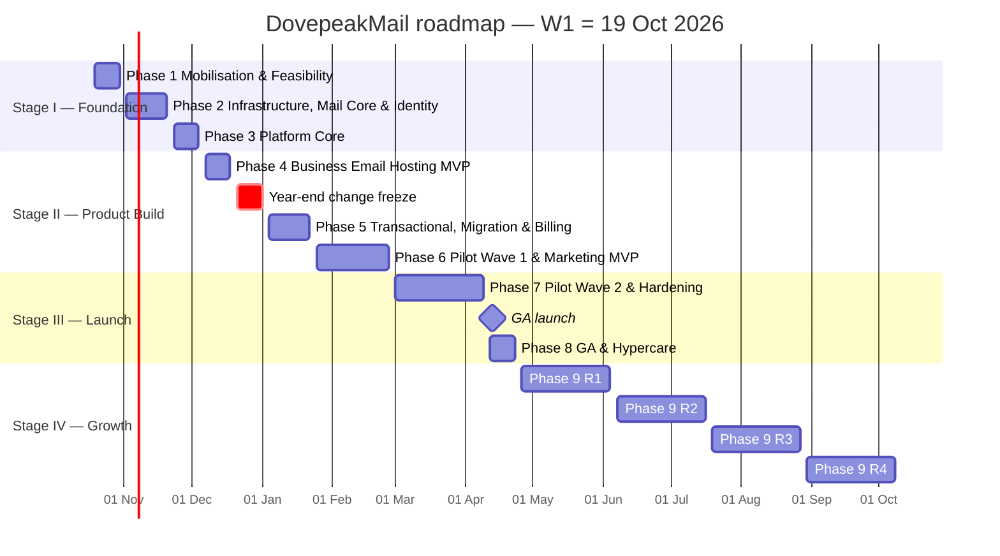
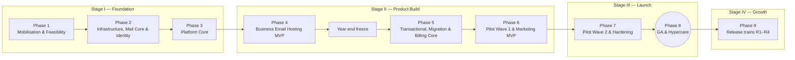

# DovepeakMail — Implementation Roadmap

| | |
|---|---|
| **Document** | DovepeakMail Implementation Roadmap and Delivery Checklist |
| **Owner** | Dovepeak Technologies — DovepeakMail programme |
| **Version** | 3.0 (baseline) |
| **Date** | 13 October 2026 |
| **Status** | For approval at Phase 1 kickoff |
| **Related documents** | [product-specification.md](product-specification.md) — *what* we are building · [IMPLEMENTATION_PLAN.md](IMPLEMENTATION_PLAN.md) — *how* we will build it · **this document** — *when, in what order, and how we track completion* |

This roadmap is the authoritative schedule **and** the working checklist for building DovepeakMail end to end. It covers the three products (Business Email Hosting, Transactional Email & Developer API, Bulk & Marketing Email) and the shared platform beneath them. It runs from kickoff, through general availability, into post-launch growth. Every phase, track, task, milestone and gate is listed in execution order, with a checkbox to tick when it is done.

---

## Contents

1. [Roadmap structure and conventions](#1-roadmap-structure-and-conventions)
2. [Programme progress tracker](#2-programme-progress-tracker)
3. [Roadmap summary](#3-roadmap-summary)
4. [Capability readiness by phase](#4-capability-readiness-by-phase)
5. [Team and track ownership](#5-team-and-track-ownership)
6. [Continuous workstreams](#6-continuous-workstreams)
7. [Stage I — Foundation](#stage-i--foundation): [Phase 1](#phase-1--mobilisation-and-feasibility) · [Phase 2](#phase-2--infrastructure-mail-core-and-identity) · [Phase 3](#phase-3--platform-core-domains-administration-and-operations)
8. [Stage II — Product Build](#stage-ii--product-build): [Phase 4](#phase-4--business-email-hosting-mvp) · [Year-end freeze](#year-end-change-freeze-not-a-phase) · [Phase 5](#phase-5--transactional-platform-migration-and-billing-core) · [Phase 6](#phase-6--pilot-wave-1-and-marketing-mvp)
9. [Stage III — Launch](#stage-iii--launch): [Phase 7](#phase-7--pilot-wave-2-and-production-hardening) · [Phase 8](#phase-8--general-availability-and-hypercare)
10. [Stage IV — Growth](#stage-iv--growth): [Phase 9](#phase-9--post-ga-release-trains)
11. [Master schedule index](#11-master-schedule-index)
12. [Gate review procedure](#12-gate-review-procedure)
13. [Governance, reporting and change control](#13-governance-reporting-and-change-control)
14. [Change log](#14-change-log)

---

## 1. Roadmap structure and conventions

### 1.1 Hierarchy

```
Stage  (I–IV)          a group of phases with one business outcome
 └─ Phase (1–9)        a fixed, non-overlapping block of weeks, executed strictly in order
     ├─ Track (A, B…)  a parallel line of work inside a phase, with one owner
     │   └─ Task       an implementation item (feature, configuration, document) — one checkbox
     ├─ Milestone      a demonstrable result with an acceptance check and a date — one checkbox
     └─ Gate           the single go/no-go review that closes the phase — one checkbox per criterion
```

- **Phases never overlap.** Phase *n+1* starts only when Gate *n* has passed (or passed with recorded conditions).
- **Parallel work lives in tracks** inside a phase.
- Some tracks continue across a phase boundary (for example, billing). Their work is then split into a named part in each phase.

### 1.2 Identifiers

| Item | Format | Example |
|---|---|---|
| Stage | Roman numeral | Stage II |
| Phase | `Phase n` (1–9) | Phase 5 |
| Track | `<phase><letter>` | Track 5B — Migration |
| Task | `<track>.<n>` | 5B.4 |
| Milestone | `M<phase>.<n>`, numbered in date order within the phase | M5.4 |
| Gate | `G<phase>` | G5 |
| Week | `W<n>`; **W1 = week of Monday 19 October 2026** | W12 = 4–8 Jan 2027 |

### 1.3 How to tick a checkbox

1. **Edit the source:** change `- [ ]` to `- [x]`.
2. **Sign it:** append the completion date and your initials, e.g. `- [x] **2A.7** Redis-T deployed … — ✔ 2026-11-12 · JM`.
3. **Definition of done**, which must be true before ticking:
   - **Task:** merged to `main`, deployed to the environment named in the task (staging by default), covered by tests or a written verification note, and documented (README, runbook or ADR as applicable).
   - **Milestone:** its acceptance check has been **demonstrated** (demo, test report or evidence link), not merely coded. Add the evidence link under the milestone.
   - **Gate criterion:** confirmed at the gate review meeting against evidence (see §12).
   - **Phase (in §2):** tick only after the gate decision is recorded as *Pass* or *Pass with conditions*.
4. **Never untick silently.** If something regresses, leave it ticked, add a line beneath it (`↳ ⚠ regressed 2026-12-02 — see issue #123`), and track the fix as a new task.
5. **Not applicable:** strike through and explain, e.g. `- [x] ~~**4B.6** POP3 access~~ — N/A, decided in ADR-07`.

### 1.4 Status and dates

- RAG per phase: 🟢 on track · 🟡 at risk (≤ 1 week slip, or an open dependency) · 🔴 off track (> 1 week slip on the critical path, or a failed gate).
- All dates are **targets**, changed only through change control (§13.3).
- Public holidays and buffers are already included: Mashujaa Day (Tue 20 Oct 2026), the year-end change freeze (W10–W11), Good Friday (26 Mar 2027) and Easter Monday (29 Mar 2027). Eid al-Fitr (≈ 10 Mar 2027, date by gazette) is a floating day off.

---

## 2. Programme progress tracker

Tick a phase only when its gate decision is recorded (§1.3).

**Stage I — Foundation**
- [ ] **Phase 1 — Mobilisation and Feasibility** · W1–W2 · 19 Oct – 30 Oct 2026 · Gate G1 passed
- [ ] **Phase 2 — Infrastructure, Mail Core and Identity** · W3–W5 · 2 Nov – 20 Nov 2026 · Gate G2 passed
- [ ] **Phase 3 — Platform Core: Domains, Administration and Operations** · W6–W7 · 23 Nov – 4 Dec 2026 · Gate G3 passed

**Stage II — Product Build**
- [ ] **Phase 4 — Business Email Hosting MVP** · W8–W9 · 7 Dec – 18 Dec 2026 · Gate G4 passed
- [ ] *Year-end change freeze observed* · W10–W11 · 21 Dec 2026 – 1 Jan 2027
- [ ] **Phase 5 — Transactional Platform, Migration and Billing Core** · W12–W14 · 4 Jan – 22 Jan 2027 · Gate G5 passed
- [ ] **Phase 6 — Pilot Wave 1 and Marketing MVP** · W15–W19 · 25 Jan – 26 Feb 2027 · Gate G6 passed

**Stage III — Launch**
- [ ] **Phase 7 — Pilot Wave 2 and Production Hardening** · W20–W25 · 1 Mar – 9 Apr 2027 · Gate G7 (go/no-go) passed
- [ ] **Phase 8 — General Availability and Hypercare** · W26–W27 · 12 Apr – 23 Apr 2027 · Gate G8 passed

**Stage IV — Growth**
- [ ] **Phase 9 / R1 — Developer growth and hosting gaps** · 26 Apr – 4 Jun 2027 · Gate G9.R1 passed
- [ ] **Phase 9 / R2 — Native webmail beta and marketing depth** · 7 Jun – 16 Jul 2027 · Gate G9.R2 passed
- [ ] **Phase 9 / R3 — Migration and market reach** · 19 Jul – 27 Aug 2027 · Gate G9.R3 passed
- [ ] **Phase 9 / R4 — Collaboration and enterprise** · 30 Aug – 8 Oct 2027 · Gate G9.R4 passed

**Product launch milestones**
- [ ] Dovepeak staff on DovepeakMail hosting (M4.6 · 18 Dec 2026)
- [ ] All Dovepeak system email sent via own Transactional stream (5A.20 · 22 Jan 2027)
- [ ] Pilot Wave 1 live — Hosting + Transactional (M6.1 · 25 Jan 2027)
- [ ] Stream isolation proven (M6.7 · 26 Feb 2027)
- [ ] Pilot Wave 2 live — all three products (M7.2 · 12 Mar 2027)
- [ ] **General availability (M8.1 · Tue 13 Apr 2027)**
- [ ] First paid revenue (M8.2 · 16 Apr 2027)

---

## 3. Roadmap summary

### 3.1 Phases at a glance

| Stage | Phase | Weeks | Dates | Outcome | Gate |
|---|---|---|---|---|---|
| **I — Foundation** | **1 — Mobilisation and Feasibility** | W1–W2 | 19 Oct – 30 Oct 2026 | Mail delivery proven from our own IPs; architecture, team, budget and repo in place | G1 · 30 Oct 2026 |
| | **2 — Infrastructure, Mail Core and Identity** | W3–W5 | 2 Nov – 20 Nov 2026 | Mail flowing for Dovepeak staff; T/B sending pools separated; users and accounts with tenant isolation | G2 · 20 Nov 2026 |
| | **3 — Platform Core: Domains, Administration and Operations** | W6–W7 | 23 Nov – 4 Dec 2026 | Shared domain management, SSO, audit, ops console, billing catalogue; provisioning backend | G3 · 4 Dec 2026 |
| **II — Product Build** | **4 — Business Email Hosting MVP** | W8–W9 | 7 Dec – 18 Dec 2026 | Hosting product complete; Dovepeak fully on it; Transactional API foundation | G4 · 18 Dec 2026 |
| | *Year-end change freeze* | W10–W11 | 21 Dec 2026 – 1 Jan 2027 | No production changes | — |
| | **5 — Transactional Platform, Migration and Billing Core** | W12–W14 | 4 Jan – 22 Jan 2027 | Transactional product complete; migration tooling; invoicing and M-Pesa | G5 · 22 Jan 2027 |
| | **6 — Pilot Wave 1 and Marketing MVP** | W15–W19 | 25 Jan – 26 Feb 2027 | Real customers on Hosting + Transactional; billing complete; Marketing complete; stream isolation proven | G6 · 26 Feb 2027 |
| **III — Launch** | **7 — Pilot Wave 2 and Production Hardening** | W20–W25 | 1 Mar – 9 Apr 2027 | All products piloted on GA topology; security, DR, load and abuse proven; go/no-go | G7 · 9 Apr 2027 |
| | **8 — General Availability and Hypercare** | W26–W27 | 12 Apr – 23 Apr 2027 | **Public paid launch Tue 13 Apr 2027**; stable operations | G8 · 23 Apr 2027 |
| **IV — Growth** | **9 — Post-GA Release Trains** | W28–W51 | 26 Apr – 8 Oct 2027 | Four 6-week release trains (R1–R4) | G9.R1–R4 |

### 3.2 Timeline



### 3.3 Phase sequence and key dependencies



| Needs… | …which comes from | Reason |
|---|---|---|
| Hosting admin (Phase 4) | Provisioning backend (M3.7), domains (M3.1–M3.2) | Mailboxes are created on verified domains through the provisioning worker |
| Transactional sending (Phase 5) | Separate T/B pools (M2.5), DKIM keys (M3.2), `send-api` foundation (M4.4) | T messages must leave only via the T pool, signed per domain |
| Migration (Phase 5) | Hosting MVP (G4) | Migration targets must be live mailboxes |
| Usage-based billing (Phase 5) | Event pipeline (M5.3) | Usage is rated from delivery events |
| Pilot Wave 1 (Phase 6) | G5 | Pilot customers need Transactional, migration and invoices |
| Marketing (Phase 6) | Sending core, events, suppression (Phase 5) | Campaigns reuse the renderer, event pipeline and suppression service |
| Pilot Wave 2 (Phase 7) | G6 | Marketing traffic cannot reach customers until stream isolation is proven |

**Critical path:** Phase 1 → identity and accounts (Track 2B) → domains (Track 3A) → `send-api` foundation (Track 4D) → sending core (Track 5A) → campaign engine (Track 6D) → hardening (Phase 7) → GA. A one-week slip on any of these moves GA by one week.

---

## 4. Capability readiness by phase

| Capability | Built | Internal use | Pilot | GA |
|---|---|---|---|---|
| Mail infrastructure (MX, submission, IMAP, cells, KumoMTA pools) | Phase 2 | Phase 2 | Phase 6 | Phase 8 |
| Accounts, identity, MFA, roles, tenant isolation | Phase 2 | Phase 3 | Phase 6 | Phase 8 |
| Unified domain management (verify, DNS checks, DKIM) | Phase 3 | Phase 3 | Phase 6 | Phase 8 |
| Audit log, policies, ops console | Phase 3 | Phase 3 | Phase 6 | Phase 8 |
| **Business Email Hosting** | Phase 4 | Phase 4 | Phase 6 (Wave 1) | Phase 8 |
| **Transactional Email & API** | Phases 4–5 | Phase 5 (system email) | Phase 6 (Wave 1) | Phase 8 |
| Migration (IMAP) | Phase 5 | Phase 5 | Phase 6 (Wave 1) | Phase 8 |
| Billing — invoices, M-Pesa | Phase 5 | — | Phase 6 | Phase 8 |
| Billing — cards, eTIMS, dunning | Phase 6 | — | Phase 6 | Phase 8 |
| **Bulk & Marketing Email** | Phase 6 | Phase 6 (own newsletter) | Phase 7 (Wave 2) | Phase 8 |
| GA topology (second failure domain) | Phase 7 | Phase 7 | Phase 7 | Phase 8 |
| Native webmail, automation, shared mailboxes, API migrations, etc. | Phase 9 | Phase 9 | Phase 9 | Phase 9 (per train) |

---

## 5. Team and track ownership

| Code | Role | Primary tracks |
|---|---|---|
| **TL** | Tech lead / architect | Architecture, gates, security reviews, isolation invariant |
| **SRE** | Mail-systems SRE (lead) | Infrastructure, mail stack, KumoMTA, backups, monitoring, DR |
| **BE-1** | Backend engineer — Platform | Identity, accounts, OIDC, audit, migration, marketing audience |
| **BE-2** | Backend engineer — Sending | Domains & DNS, `send-api`, sending core, campaign engine |
| **BE-3** | Backend engineer — Hosting & Billing | Provisioning, hosting, events/suppression, billing, tracking/reputation |
| **FE-1** | Frontend engineer — Customer portal | Design system, portal, hosting admin, billing UI, audience UI |
| **FE-2** | Frontend engineer — Ops & developer UX | Ops console, webmail branding, developer portal, campaign editor |
| **DL** | Deliverability & abuse lead | IP warm-up, FBLs, review queues, policies, abuse cases |
| **QA** | QA / test automation (from W6) | Isolation harness, e2e, mail-flow, load, stream-isolation tests |
| **PM** | Product manager | Backlog, pilot programme, pricing, legal coordination |
| **DS** | Product designer | Brand system, wireframes, usability testing |
| **SUP** | Support (from W18) | Pilot onboarding, tickets, knowledge base |
| **FIN / LEGAL** | Finance / counsel (part-time) | Cost model, VAT/eTIMS, policies, ODPC |

---

## 6. Continuous workstreams

These run alongside every phase. Their checkpoints feed the gates.

### 6.1 Hiring and mobilisation — owner: Leadership
- [ ] Mail-systems SRE signed (by W2, 30 Oct 2026). *G1 condition*
- [ ] Deliverability & abuse lead signed (by W2, 30 Oct 2026). *G1 condition*
- [ ] Three backend and two frontend engineers confirmed (by W2)
- [ ] QA engineer onboarded (by W6, 23 Nov 2026)
- [ ] Support staff onboarded and trained (by W18, 15 Feb 2027)
- [ ] Customer-facing on-call rota staffed (by W15, 25 Jan 2027)

### 6.2 Deliverability and IP warm-up — owner: DL
- [ ] W2 — Spike IPs tested at Gmail, Outlook and Yahoo
- [ ] W5 — Staff mailbox traffic (Stream M) and internal system mail (Stream T) live
- [ ] W5 — Weekly deliverability review started
- [ ] W5 — Google Postmaster Tools, Microsoft SNDS/JMRP and Yahoo CFL registrations done
- [ ] W14 — All Dovepeak system email on own Stream T
- [ ] W15 — Pilot Stream M and Stream T traffic monitored daily
- [ ] W19 — Dovepeak's own marketing newsletter sent via Stream B (first B warm-up)
- [ ] W21–W25 — Pilot Stream B warm-up ramp completed per schedule
- [ ] W25 — Seed-test inbox placement ≥ 90 % (M and T) at Gmail, Outlook and Yahoo

### 6.3 Security — owner: TL
- [ ] W2 — Threat model v1
- [ ] W2 — SAST, dependency and secret scanning running in CI
- [ ] Security review held at G1 · G2 · G3 · G4 · G5 · G6 · G7 (tick each in the gate checklist)
- [ ] W22–W23 — External penetration test executed
- [ ] W25 — All critical/high findings closed
- [ ] W26 — `security.txt` and vulnerability disclosure policy published

### 6.4 Legal and compliance — owner: PM + LEGAL
- [ ] W2 — Legal drafting plan agreed with counsel
- [ ] W4 — eTIMS integration route chosen
- [ ] W8 — Kenya DPA / DPIA for mailbox and marketing processing drafted
- [ ] W12 — ODPC registration filed
- [ ] W14 — Pilot agreement template approved
- [ ] W22 — ToS, AUP, Privacy, DPA, Retention, Support Access and Sub-processor list final
- [ ] W25 — All policies published on the website

### 6.5 Design and UX — owner: DS
- [ ] W2 — Brand tokens and wireframes for six key screens
- [ ] Designs delivered one phase ahead of build (tick at each gate: G2 · G3 · G4 · G5)
- [ ] W16 — Usability test #1 with Pilot Wave 1 customers
- [ ] W21 — Usability test #2 with Pilot Wave 2 customers

### 6.6 Documentation — owner: each track owner
- [ ] A runbook exists for every alert before the gate that introduces it
- [ ] W13 — Public docs site (`docs.dovepeakmail.com`) live
- [ ] W18 — Customer knowledge base v1 (DNS guides, client setup, API quickstart)
- [ ] W25 — Docs freeze for GA

### 6.7 Cost and pricing — owner: PM + FIN
- [ ] W2 — Cost model at 10/50/100/500/1,000 mailboxes and 1M/10M sends
- [ ] W8 — Cost model refreshed with real infrastructure bills
- [ ] W18 — Cost model refreshed with pilot usage
- [ ] W24 — Final price list approved by leadership

### 6.8 Operational readiness — owner: SRE
- [ ] W5 — Internal on-call rota live
- [ ] W15 — Customer-facing on-call rota live
- [ ] Restore drill #1 (W5) · #2 (W9) · #3 (W14) · #4 (W19) · #5 (W23) — each recorded in its phase checklist
- [ ] From W28 — Monthly restore drills scheduled

---

# Stage I — Foundation

**Stage outcome:** a proven, observable mail platform running Dovepeak's own email, with the shared account, identity and domain foundation that all three products will use.

---

## Phase 1 — Mobilisation and Feasibility

| | |
|---|---|
| **Weeks / dates** | W1–W2 · Mon 19 Oct – Fri 30 Oct 2026 (Tue 20 Oct public holiday) |
| **Objective** | Prove we can deliver email from infrastructure we control; lock the architecture; mobilise team, budget and engineering foundation |
| **Entry criteria** | Leadership approval to start; budget for spike VMs and test IPs; SRE engaged (contractor acceptable until hired) |
| **Team** | TL, SRE, DL, BE-2, FE-1, DS, PM, FIN, LEGAL |

### Week-by-week

| Week | Track 1A | Track 1B | Track 1C | Track 1D |
|---|---|---|---|---|
| **W1** (19–23 Oct) | Provider questionnaires; spike VMs + IPs ordered; blocklist checks | ADR drafts; threat-model workshop scheduled | Repo scaffold; CI lint/typecheck/test | Scope workshop; legal kickoff; cost-model template |
| **W2** (26–30 Oct) | Mail-stack and KumoMTA spikes; test sends + header evidence | ADR reviews; threat model v1; ERD v1 + RLS prototype; OpenAPI v0 | Brand tokens; CI build + branch protection | Wireframes; cost model; **G1 review Fri 30 Oct** |

### Implementation checklist

**Track 1A — Provider and deliverability feasibility** · owner SRE + DL
- [ ] **1A.1** Provider questionnaire sent to ≥ 4 providers (port 25, PTR, extra IPv4/BYOIP, DC location, DDoS, NVMe/snapshots, private network)
- [ ] **1A.2** Written answers received from ≥ 2 providers and filed in `docs/feasibility/`
- [ ] **1A.3** Candidate IPs checked against Spamhaus, Barracuda, SpamCop and Microsoft SNDS history
- [ ] **1A.4** Spike VMs and 3 test IPv4 addresses procured
- [ ] **1A.5** Spike test domain registered; DNS zone configured
- [ ] **1A.6** PTR and HELO names set and forward/reverse DNS aligned on spike IPs
- [ ] **1A.7** Postfix + Dovecot + Rspamd spike installed; send/receive working
- [ ] **1A.8** KumoMTA spike installed with two pools on two IPs; HTTP injection tested
- [ ] **1A.9** Test sends to Gmail, Outlook and Yahoo from both paths; full headers archived
- [ ] **1A.10** Spike report written (findings, risks, recommendation)
- [ ] **1A.11** IP strategy drafted (lease vs acquire a block, pilot and GA IP counts)

**Track 1B — Architecture and design baseline** · owner TL
- [ ] **1B.1** ADR-01…ADR-16 drafted in `docs/adr/`
- [ ] **1B.2** Dovecot CE 2.4 capabilities verified (proxying, replication options, licence)
- [ ] **1B.3** Licence review completed: Roundcube, KumoMTA, Rspamd, ClamAV, imapflow, MJML
- [ ] **1B.4** ORM decision recorded (Drizzle recommended)
- [ ] **1B.5** Threat-model workshop held; threat model v1 written
- [ ] **1B.6** Data-flow diagram with trust boundaries
- [ ] **1B.7** ERD v1 (control plane) and ClickHouse event schema draft
- [ ] **1B.8** RLS prototype with a passing cross-tenant test
- [ ] **1B.9** `send-api` OpenAPI v0 and webhook event schema reviewed
- [ ] **1B.10** All ADRs reviewed and merged

**Track 1C — Engineering foundation** · owner TL + FE-1
- [ ] **1C.1** Monorepo created (pnpm workspaces + Turborepo)
- [ ] **1C.2** App skeletons: `web`, `core-api`, `send-api`, `workers`
- [ ] **1C.3** Package skeletons: `db`, `domain`, `contracts`, `email-render`, `dns-tools`, `ui`, `config`, `testing`
- [ ] **1C.4** Shared ESLint, Prettier and tsconfig presets (strict TypeScript)
- [ ] **1C.5** CI pipeline: lint, typecheck, unit tests, build
- [ ] **1C.6** Branch protection, CODEOWNERS, PR template, conventional commits
- [ ] **1C.7** Secret scanning and dependency scanning in CI
- [ ] **1C.8** Local Docker Compose: Postgres, Redis ×3, ClickHouse, Mailpit
- [ ] **1C.9** Brand tokens (colours, typography, spacing) in `packages/ui`

**Track 1D — Product, commercial and legal baseline** · owner PM + DS + FIN + LEGAL
- [ ] **1D.1** Scope workshop held; MVP boundary and non-goals document signed
- [ ] **1D.2** Pilot order confirmed (Hosting + Transactional first, Marketing second)
- [ ] **1D.3** Wireframes: onboarding, domain page, mailbox list, API keys, campaign editor, ops tenant view
- [ ] **1D.4** Cost model completed at five scales
- [ ] **1D.5** Legal kickoff; drafting plan for ToS, AUP, Privacy, DPA, Retention
- [ ] **1D.6** ODPC applicability assessment started
- [ ] **1D.7** eTIMS integration options listed
- [ ] **1D.8** Leadership decisions (implementation plan §18) assigned owners and dates
- [ ] **1D.9** MVP backlog created in the tracker and mapped to phases, tracks and milestones

### Milestones

- [ ] **M1.1 — Kickoff and scope agreed** · Fri 23 Oct · PM
  - Acceptance: MVP boundaries, target segments, non-goals and pilot order signed.
- [ ] **M1.2 — Provider and IP feasibility confirmed** · Fri 30 Oct · SRE
  - Acceptance: ≥ 2 providers confirm outbound port 25 and editable PTR **in writing**; candidate IPs clean; data-residency position drafted.
- [ ] **M1.3 — Deliverability spike passed** · Fri 30 Oct · SRE + DL
  - Acceptance: messages via the Postfix path (M) and KumoMTA path (T) land at Gmail, Outlook and Yahoo with SPF, DKIM and DMARC **pass**; headers archived.
- [ ] **M1.4 — Architecture baseline approved** · Fri 30 Oct · TL
  - Acceptance: ADR-01…16 merged; threat model v1; ERD v1; OpenAPI v0 reviewed.
- [ ] **M1.5 — Engineering foundation ready** · Fri 30 Oct · TL
  - Acceptance: monorepo with all app and package skeletons; CI green on `main`.
- [ ] **M1.6 — Commercial and design baseline ready** · Fri 30 Oct · PM + DS
  - Acceptance: cost model at five scales; six wireframes approved.
- [ ] **M1.7 — Key hires secured** · Fri 30 Oct · Leadership
  - Acceptance: mail-systems SRE and deliverability/abuse lead signed.

### Deliverables
Provider comparison matrix and written confirmations · spike report · ADRs · threat model · ERD · OpenAPI v0 · wireframes · cost model · legal plan · repo + CI · MVP backlog.

### Gate G1 — Feasibility (Fri 30 Oct 2026)
- [ ] All Phase 1 milestones (M1.1–M1.7) complete
- [ ] Delivery feasibility demonstrated from IPs we can actually procure
- [ ] Two-provider strategy and IP budget approved
- [ ] Leadership decisions (implementation plan §18) answered or assigned with dates
- [ ] Budget for Phases 2–8 approved
- [ ] Security review held: threat model accepted
- [ ] **Gate decision recorded:** ☐ Pass ☐ Pass with conditions ☐ Fail — date / approver: ________

---

## Phase 2 — Infrastructure, Mail Core and Identity

| | |
|---|---|
| **Weeks / dates** | W3–W5 · Mon 2 Nov – Fri 20 Nov 2026 |
| **Objective** | Stand up production-shaped (pilot-sized) infrastructure with real mail flowing for Dovepeak staff; build identity, accounts and tenant isolation |
| **Entry criteria** | G1 passed; provider accounts and IPs provisioned; DNS for `dovepeakmail.com` and `dpmsend.com` under our control |
| **Team** | SRE, TL, DL, BE-1, BE-2, FE-1, FE-2, DS |

### Week-by-week

| Week | Track 2A | Track 2B | Track 2C | Track 2D |
|---|---|---|---|---|
| **W3** (2–6 Nov) | Terraform; hardening; WireGuard; PTR; TLS | Schema, migrations, RLS, module skeletons | Design-system components | DNS record generator |
| **W4** (9–13 Nov) | Postgres, Redis ×3, ClickHouse; MX, submission, Dovecot proxy, cell 1 + standby | Sign-up, sign-in, sessions, MFA, password reset | Portal shell + auth screens | SPF/DKIM/DMARC parsers |
| **W5** (16–20 Nov) | KumoMTA pools; monitoring; restore drill #1; staff mail live | Accounts, roles, invitations; isolation harness; audit outbox | Account switcher, settings | KumoMTA policy endpoints; **G2 review Fri 20 Nov** |

### Implementation checklist

**Track 2A — Infrastructure and mail core** · owner SRE
- *Infrastructure as code*
  - [ ] **2A.1** Terraform: private network, firewall rules, VMs per role, object-storage buckets
  - [ ] **2A.2** Terraform: DNS zones for `dovepeakmail.com` and `dpmsend.com`
  - [ ] **2A.3** Ansible base role: SSH keys only, automatic security updates, auditd, CrowdSec/fail2ban
  - [ ] **2A.4** WireGuard admin VPN; no public SSH
  - [ ] **2A.5** PTR records and HELO hostnames for every mail IP
  - [ ] **2A.6** ACME TLS automation for all service hostnames
- *Data services*
  - [ ] **2A.7** PostgreSQL 16 primary + streaming replica
  - [ ] **2A.8** pgBackRest to the off-site, object-locked bucket; PITR restore tested
  - [ ] **2A.9** Redis-control, Redis-T and Redis-B deployed as separate instances
  - [ ] **2A.10** ClickHouse deployed; event schema bootstrapped
- *Mailbox plane (Stream M)*
  - [ ] **2A.11** MX: Postfix with postscreen, RBL weighting, TLS, size limits
  - [ ] **2A.12** Rspamd (DKIM/SPF/DMARC/ARC verification, Bayes, fuzzy) + ClamAV
  - [ ] **2A.13** Submission on 587 (STARTTLS) and 465 (TLS) with SASL via Dovecot and sender-login enforcement
  - [ ] **2A.14** Outbound DKIM signing for Stream M (selector `dpm`) via Rspamd
  - [ ] **2A.15** Dovecot proxy + mailbox cell 1 on ZFS mirror (IMAP 993, LMTP, quota, FTS, Sieve)
  - [ ] **2A.16** Standby cell receiving `zfs send` snapshots every ≤ 15 min
  - [ ] **2A.17** `mailcfg` read-only views + restricted DB role; Postfix `proxymap` caching
- *Sending plane (Streams T and B)*
  - [ ] **2A.18** KumoMTA T node group with pools `tx-trusted`, `tx-new`
  - [ ] **2A.19** KumoMTA B node group with pools `mkt-trusted`, `mkt-new`, `mkt-probation`
  - [ ] **2A.20** Stream-header enforcement: each node group rejects the other stream's messages
  - [ ] **2A.21** DKIM signing in KumoMTA with keys from the secret store (never plaintext on disk)
  - [ ] **2A.22** KumoMTA log hook posting to a test event ingestor
- *Observability and operations*
  - [ ] **2A.23** Prometheus, Alertmanager, Grafana, Loki deployed
  - [ ] **2A.24** Exporters: node, Postfix, Dovecot, Rspamd, KumoMTA, Postgres, Redis, ClickHouse
  - [ ] **2A.25** Alert rules: disk, queue growth, certificate expiry, backup failure, service down
  - [ ] **2A.26** Restore drill #1 executed and timed
  - [ ] **2A.27** Dovepeak staff domain moved; staff mailboxes live
  - [ ] **2A.28** `postmaster@` and `abuse@` mailboxes live; DMARC `rua` for own domains
  - [ ] **2A.29** Runbooks: restore, cell failover, certificate renewal, IP blocklisted

**Track 2B — Identity, accounts and tenant isolation** · owner BE-1
- [ ] **2B.1** Identity and accounts schema + migrations
- [ ] **2B.2** RLS policies and request interceptor setting `app.account_id`
- [ ] **2B.3** Sign-up with email verification
- [ ] **2B.4** Sign-in with Argon2id password hashing
- [ ] **2B.5** Sessions: httpOnly cookies, server-side store, list and revoke
- [ ] **2B.6** TOTP enrolment with recovery codes
- [ ] **2B.7** Passkeys (WebAuthn)
- [ ] **2B.8** Password reset flow
- [ ] **2B.9** Breached-password check (k-anonymity)
- [ ] **2B.10** Rate limiting and brute-force protection per IP and per account
- [ ] **2B.11** Accounts, memberships, roles and permission bundles
- [ ] **2B.12** Invitations (send, accept, expire, revoke)
- [ ] **2B.13** Ownership transfer with re-authentication
- [ ] **2B.14** Isolation harness running in CI on every PR
- [ ] **2B.15** Audit outbox writing events in the same transaction

**Track 2C — Portal shell and design system** · owner FE-1 + DS
- [ ] **2C.1** Core components: buttons, forms, tables, dialogs, toasts, tabs, badges, empty/error/loading states
- [ ] **2C.2** Light and dark themes from brand tokens
- [ ] **2C.3** Portal shell and navigation: Overview · Domains · Email Hosting · Transactional · Marketing · Billing · Settings
- [ ] **2C.4** Auth screens: sign-up, sign-in, MFA, reset, verify email
- [ ] **2C.5** Account switcher and settings pages
- [ ] **2C.6** i18n framework (English; Swahili placeholder catalogue)
- [ ] **2C.7** Accessibility check (WCAG 2.2 AA contrast, keyboard navigation)

**Track 2D — DNS toolkit and KumoMTA policy endpoints** · owner BE-2
- [ ] **2D.1** DNS record generator per capability in `packages/dns-tools`
- [ ] **2D.2** SPF parser with DNS-lookup counter and merge helper
- [ ] **2D.3** DKIM and DMARC parsers/validators
- [ ] **2D.4** Unit tests for all DNS tools (≥ 90 % coverage)
- [ ] **2D.5** Internal policy endpoints for KumoMTA (tenant → pool, DKIM reference, suspension flag) with caching

### Milestones

- [ ] **M2.1 — Infrastructure-as-code baseline** · Fri 6 Nov · SRE
  - Acceptance: staging rebuilt from scratch by Terraform + Ansible; no manual host changes.
- [ ] **M2.2 — Data services with backups** · Fri 13 Nov · SRE
  - Acceptance: PITR restore tested; three separate Redis instances; ClickHouse accepting inserts; backups in an off-site object-locked bucket.
- [ ] **M2.3 — Mailbox plane live** · Fri 13 Nov · SRE
  - Acceptance: inbound mail passes Rspamd; IMAP 993 via proxy works; submission enforces sender-login match; standby snapshots every ≤ 15 min.
- [ ] **M2.4 — Identity live** · Fri 13 Nov · BE-1
  - Acceptance: user signs up, verifies email, enrols MFA, signs in; sessions listable and revocable; brute-force throttling verified.
- [ ] **M2.5 — Sending plane with separated pools** · Fri 20 Nov · SRE + BE-2
  - Acceptance: T-tagged mail leaves only via `tx-*` IPs and B-tagged only via `mkt-*`; a mis-tagged message is **rejected** by the wrong node group.
- [ ] **M2.6 — Accounts, roles and tenant isolation** · Fri 20 Nov · BE-1
  - Acceptance: roles enforce permissions; the isolation suite fails the build on any cross-tenant read.
- [ ] **M2.7 — Portal shell on brand system** · Fri 20 Nov · FE-1
  - Acceptance: branded portal (navy `#000027`, orange `#ff6300`, green `#2f821a`, off-white `#f8f8ff`; Open Sans / Lato), WCAG AA, responsive.
- [ ] **M2.8 — Observability, DR and dogfooding** · Fri 20 Nov · SRE
  - Acceptance: alerts fire on simulated disk-full, queue spike, cert expiry and backup failure; Postgres + one mailbox restored off-site within pilot RPO/RTO; all staff mail on the platform.

### Deliverables
`infra/terraform`, `infra/ansible` roles · monitoring dashboards · runbooks · `identity` and `accounts` modules · isolation harness · `packages/ui` · `packages/dns-tools`.

### Gate G2 — Foundations live (Fri 20 Nov 2026)
- [ ] All Phase 2 milestones (M2.1–M2.8) complete
- [ ] Internal mail flows both ways with SPF/DKIM/DMARC alignment
- [ ] T/B pool separation proven (M2.5)
- [ ] Restore drill #1 meets pilot RPO/RTO
- [ ] Security review held: no open critical infrastructure or auth findings
- [ ] **Gate decision recorded:** ☐ Pass ☐ Pass with conditions ☐ Fail — date / approver: ________

---

## Phase 3 — Platform Core: Domains, Administration and Operations

| | |
|---|---|
| **Weeks / dates** | W6–W7 · Mon 23 Nov – Fri 4 Dec 2026 |
| **Objective** | Complete the shared platform: unified domain management, SSO, audit, policies, ops console and billing catalogue. Build the mailbox provisioning backend that Phase 4 depends on |
| **Entry criteria** | G2 passed |
| **Team** | BE-1, BE-2, BE-3, FE-1, FE-2, SRE, QA (joins W6), DS |

### Week-by-week

| Week | Track 3A | Track 3B | Track 3C | Track 3D |
|---|---|---|---|---|
| **W6** (23–27 Nov) | Claim + verify; capabilities; record generation; DNS checker; DKIM keys | OIDC provider; audit log UI | Billing catalogue; ops tenant search | Hosting schema; `mailcfg` views; provisioning worker skeleton |
| **W7** (30 Nov – 4 Dec) | Domain page UI; checker schedule; Domain Connect spike | Dovecot OAUTHBEARER; policies | Ops diagnostics + suspend/restore; manual invoices; onboarding wizard | doveadm integration; quota sync; **G3 review Fri 4 Dec** |

### Implementation checklist

**Track 3A — Unified domain management** · owner BE-2 + FE-1
- [ ] **3A.1** Domain claim with TXT verification token (hashed at rest)
- [ ] **3A.2** Uniqueness rule: a domain can be actively claimed by only one account
- [ ] **3A.3** Domain lifecycle states (Pending verification → Verified → DNS incomplete → Active → Suspended → Removal pending)
- [ ] **3A.4** Capability model: `mailbox`, `transactional`, `marketing`, each with its own status
- [ ] **3A.5** Per-capability DNS record generation (MX, SPF, DKIM CNAME, DMARC, return-path, tracking)
- [ ] **3A.6** Authoritative-nameserver DNS checker with observed vs expected values
- [ ] **3A.7** Diagnostics: multiple SPF, SPF lookup count, conflicting MX, missing DKIM, DMARC syntax, proxied records
- [ ] **3A.8** Check scheduler (every 2 min for 1 h after change → hourly → daily) with degradation grace period
- [ ] **3A.9** DKIM key generation per domain and stream, envelope-encrypted with KMS
- [ ] **3A.10** Domain page UI with three capability cards and copy-paste record blocks
- [ ] **3A.11** Domain Connect integration spike (report and decision)

**Track 3B — SSO, audit and policies** · owner BE-1
- [ ] **3B.1** Embedded OIDC provider (`node-oidc-provider`)
- [ ] **3B.2** Dovecot OAUTHBEARER/XOAUTH2 against our OIDC provider
- [ ] **3B.3** Audit log UI for account admins (filter, search)
- [ ] **3B.4** Audit export (CSV/JSON) and hash-chaining per account
- [ ] **3B.5** `policies` table with scopes (platform, plan, account, mailbox, key)
- [ ] **3B.6** Policy admin in ops console; changes audited

**Track 3C — Ops console v1 and billing catalogue** · owner FE-2 + BE-1
- [ ] **3C.1** Staff identities with hardware-key MFA and staff roles
- [ ] **3C.2** Tenant search and tenant 360 view (no mail content)
- [ ] **3C.3** Domain diagnostics view for support
- [ ] **3C.4** Suspend/restore account with mandatory reason, audited
- [ ] **3C.5** Billing catalogue: products, plans, prices (KES + USD, monthly/annual)
- [ ] **3C.6** Entitlements mapped into `policies`
- [ ] **3C.7** Manual invoice creation and PDF
- [ ] **3C.8** Onboarding wizard v1 ("What do you want to do first?" → domain step)

**Track 3D — Mailbox provisioning backend** · owner BE-3 + SRE
- [ ] **3D.1** Hosting schema: mailboxes, aliases, groups, group members
- [ ] **3D.2** Final `mailcfg` views for Postfix and Dovecot (domains, mailboxes, aliases, sender-login maps, cell routing)
- [ ] **3D.3** Provisioning worker (BullMQ) with idempotent jobs and retries
- [ ] **3D.4** doveadm HTTP API integration with per-cell keys
- [ ] **3D.5** Quota sync job (`used_bytes`)
- [ ] **3D.6** Soft delete with scheduled purge
- [ ] **3D.7** Every provisioning call audited

### Milestones

- [ ] **M3.1 — Domain claim and verification** · Fri 27 Nov · BE-2
  - Acceptance: a customer adds a domain, publishes the TXT token, and the domain verifies; duplicate active claims are blocked.
- [ ] **M3.2 — DNS records, checker and DKIM keys** · Fri 27 Nov · BE-2
  - Acceptance: correct records generated per capability; checker flags multiple SPF records, conflicting MX and missing DKIM against a test zone; DKIM private keys stored only encrypted.
- [ ] **M3.3 — Audit log and policies** · Fri 27 Nov · BE-1
  - Acceptance: every sensitive action writes a visible audit event; limits come from `policies` and change without a deploy.
- [ ] **M3.4 — Single sign-on** · Fri 4 Dec · BE-1
  - Acceptance: Dovecot accepts OAUTHBEARER tokens from our OIDC provider; portal and IMAP share one identity.
- [ ] **M3.5 — Ops console v1** · Fri 4 Dec · FE-2
  - Acceptance: staff find a tenant, view diagnostics, and suspend/restore with a reason, all audited; staff MFA enforced.
- [ ] **M3.6 — Billing catalogue and manual invoices** · Fri 4 Dec · BE-1
  - Acceptance: plans and prices for all three products; entitlements feed `policies`; a manual invoice can be issued.
- [ ] **M3.7 — Mailbox provisioning backend** · Fri 4 Dec · BE-3
  - Acceptance: a mailbox created through the API is usable over IMAP within 60 s; deletion is soft with a scheduled purge; every call audited.

### Deliverables
`domains`, `audit`, `ops`, `billing` (catalogue) modules · OIDC provider · domain page · ops console v1 · provisioning worker · onboarding wizard v1 · domain runbooks.

### Gate G3 — Platform core (Fri 4 Dec 2026)
- [ ] All Phase 3 milestones (M3.1–M3.7) complete
- [ ] **Spec §15:** a customer can create an organisation and verify a domain using a DNS TXT token
- [ ] **Spec §15:** the portal detects and explains missing or incorrect MX, SPF, DKIM and DMARC records
- [ ] Isolation suite covers all domain, audit, ops and billing endpoints
- [ ] MFA enforced for owner, admin and billing roles and all staff
- [ ] Security review held: no open critical findings
- [ ] **Gate decision recorded:** ☐ Pass ☐ Pass with conditions ☐ Fail — date / approver: ________

---

# Stage II — Product Build

**Stage outcome:** all three products built and in use, with Dovepeak on Hosting and Transactional, real pilot customers on both, and Marketing proven safe by the stream-isolation test.

---

## Phase 4 — Business Email Hosting MVP

| | |
|---|---|
| **Weeks / dates** | W8–W9 · Mon 7 Dec – Fri 18 Dec 2026 |
| **Objective** | Complete the Business Email Hosting product end to end and move all of Dovepeak onto it; lay the Transactional API foundation |
| **Entry criteria** | G3 passed |
| **Team** | BE-2, BE-3, FE-1, FE-2, SRE, QA, DS |

### Week-by-week

| Week | Track 4A | Track 4B | Track 4C | Track 4D |
|---|---|---|---|---|
| **W8** (7–11 Dec) | Mailbox/alias/group API + UI; app passwords | Roundcube branding + SSO; client auto-config | Rspamd rate limits | `send-api` deployable; projects; keys; idempotency; rate limits |
| **W9** (14–18 Dec) | CSV bulk; mailbox details | Sieve/vacation/forwarding; client setup page | Compromise auto-hold; offboarding; ops views | Send + batch; sandbox; Redis-T queues; **code freeze Fri 18 Dec 17:00; G4 review** |

### Implementation checklist

**Track 4A — Hosting administration** · owner FE-1 + BE-3
- [ ] **4A.1** Mailbox create/edit/suspend/restore/delete (API + UI)
- [ ] **4A.2** Quota assignment and change; storage usage display
- [ ] **4A.3** Password reset and force sign-out by admin
- [ ] **4A.4** App passwords for IMAP/SMTP clients when MFA is enabled
- [ ] **4A.5** Aliases (within plan rules); catch-all off by default with warning
- [ ] **4A.6** Distribution groups with membership and posting policies (anyone, members, domain, moderators)
- [ ] **4A.7** Plan-limit enforcement with clear error messages
- [ ] **4A.8** CSV bulk create/update with validated template and per-row results
- [ ] **4A.9** Mailbox detail page: last login, protocols used, MFA status, sending limit
- [ ] **4A.10** "A mailbox user is a user": mailbox creation creates/links a `mailbox_user` identity

**Track 4B — Webmail and client access** · owner FE-2 + SRE
- [ ] **4B.1** Roundcube deployed at `mail.dovepeakmail.com`
- [ ] **4B.2** Roundcube branded (colours, fonts, logo from `branding/`)
- [ ] **4B.3** Roundcube SSO via OIDC → Dovecot OAUTHBEARER
- [ ] **4B.4** Plugins: managesieve, markasjunk; password plugin disabled
- [ ] **4B.5** Sieve filters, vacation responder, forwarding rules
- [ ] **4B.6** Thunderbird autoconfig, Outlook autodiscover, iOS `.mobileconfig`
- [ ] **4B.7** Client setup page with published hostnames and ports

**Track 4C — Mail safety and lifecycle** · owner BE-3
- [ ] **4C.1** Rspamd `ratelimit` per user and per tenant from `policies`
- [ ] **4C.2** Outbound spam scanning on submission
- [ ] **4C.3** Compromised-account detection (outbound score + rate anomaly + suspicious login)
- [ ] **4C.4** Auto-hold of the mailbox's outbound queue, admin alert, forced password reset
- [ ] **4C.5** Offboarding wizard: disable sign-in, revoke sessions and app passwords, convert to alias or forward, optional export
- [ ] **4C.6** Mailbox ops views: cell health, quota outliers, compromised-mailbox queue
- [ ] **4C.7** Runbooks: compromised mailbox, quota full, cell move

**Track 4D — Transactional API foundation** · owner BE-2
- [ ] **4D.1** `send-api` deployable (separate deployment and scaling from `core-api`)
- [ ] **4D.2** Projects and environments (test / live)
- [ ] **4D.3** API keys: prefix + hashed secret, scopes, IP allowlist, sender-domain restriction, expiry, revoke
- [ ] **4D.4** Auth middleware with key cache and revocation within 60 s
- [ ] **4D.5** `Idempotency-Key` store (24 h); conflicting payload → 409
- [ ] **4D.6** Token-bucket rate limits per key and per account; `RateLimit-*` headers; quotas from entitlements
- [ ] **4D.7** `POST /v1/emails` and `/v1/emails/batch` with full validation; `X-Request-Id`; problem+json errors
- [ ] **4D.8** Test-mode sandbox inbox (test keys never reach the Internet)
- [ ] **4D.9** Redis-T queues `tx.high` and `tx.normal`; dispatcher skeleton

### Milestones

- [ ] **M4.1 — Mailbox, alias and group management** · Fri 11 Dec · FE-1 + BE-3
  - Acceptance: admin creates, edits, suspends and restores mailboxes, aliases and groups within plan limits; breaches blocked with a clear message.
- [ ] **M4.2 — Webmail and client access** · Fri 11 Dec · FE-2 + SRE
  - Acceptance: user signs in once and reaches webmail; Thunderbird, Outlook and iOS auto-configure.
- [ ] **M4.3 — Bulk administration** · Fri 18 Dec · FE-1
  - Acceptance: 500-row CSV import returns per-row results; failed rows can be fixed and re-imported.
- [ ] **M4.4 — Transactional API foundation** · Fri 18 Dec · BE-2
  - Acceptance: key scoped to `emails:send` can send but not read; revoked key fails within 60 s; duplicate `Idempotency-Key` returns the original result; test keys deliver only to the sandbox.
- [ ] **M4.5 — Mail safety and offboarding** · Fri 18 Dec · BE-3
  - Acceptance: simulated compromised mailbox is auto-held and the admin alerted; offboarding disables sign-in, revokes sessions and app passwords, and converts/forwards as chosen.
- [ ] **M4.6 — Dovepeak fully on DovepeakMail hosting** · Fri 18 Dec · SRE + PM
  - Acceptance: every Dovepeak team uses DovepeakMail mailboxes as primary email.

### Deliverables
`hosting` module complete · admin console pages · branded webmail · client setup docs · hosting runbooks · `send-api` foundation.

### Gate G4 — Business Email Hosting MVP (Fri 18 Dec 2026)
- [ ] All Phase 4 milestones (M4.1–M4.6) complete
- [ ] **Spec §15:** an authorised admin can create, suspend and restore a mailbox, alias and distribution group within plan limits
- [ ] **Spec §15:** a mailbox sends and receives with webmail and supported clients; SPF/DKIM/DMARC alignment passes
- [ ] Isolation suite covers all hosting and `send-api` endpoints
- [ ] Restore drill #2 executed and within targets
- [ ] Security review held: no open critical findings
- [ ] Production change freeze in effect from 18 Dec 17:00
- [ ] **Gate decision recorded:** ☐ Pass ☐ Pass with conditions ☐ Fail — date / approver: ________

---

## Year-end change freeze (not a phase)

| | |
|---|---|
| **Weeks / dates** | W10–W11 · Mon 21 Dec 2026 – Fri 1 Jan 2027 |
| **Resumes** | Mon 4 Jan 2027, 09:00 |

- [ ] Freeze announced to the team and pilot-candidate customers (by 14 Dec)
- [ ] On-call rota for the freeze published
- [ ] No production changes made except approved emergencies (each logged with TL approval)
- [ ] No feature merges to `main` during the freeze
- [ ] Post-freeze health check completed Mon 4 Jan (alerts, backups, queues, certificates)

---

## Phase 5 — Transactional Platform, Migration and Billing Core

| | |
|---|---|
| **Weeks / dates** | W12–W14 · Mon 4 Jan – Fri 22 Jan 2027 |
| **Objective** | Complete the Transactional Email & Developer API product; deliver mailbox migration; deliver subscriptions, consolidated invoicing and M-Pesa; be ready for pilot customers |
| **Entry criteria** | G4 passed |
| **Team** | BE-1, BE-2, BE-3, FE-1, FE-2, SRE, QA, DL, FIN |

### Week-by-week

| Week | Track 5A | Track 5B | Track 5C |
|---|---|---|---|
| **W12** (4–8 Jan) | Renderer + templates; KumoMTA injection; per-domain DKIM | Schema; credential encryption; connection test + dry run | Subscriptions; entitlements; proration |
| **W13** (11–15 Jan) | Bounce/FBL; event ingestor; suppression; status + events endpoints | Sync engine; incremental sync; redaction tests | Metering; rating; consolidated invoices + VAT + PDF |
| **W14** (18–22 Jan) | Webhooks; SMTP relay; log UI; docs v1; SDKs; load test; system email on Stream T | CSV upload; cutover assistant; error export; credential deletion | M-Pesa STK Push + Paybill; reconciliation; **G5 review Fri 22 Jan** |

### Implementation checklist

**Track 5A — Sending core and Transactional product** · owner BE-2 (+ BE-3 for events) + FE-2
- *Rendering and delivery*
  - [ ] **5A.1** Renderer in `packages/email-render`: MJML → HTML, CSS inlining, text alternative, HTML sanitisation
  - [ ] **5A.2** Templates with versions (draft/published), variables schema, preview with sample data, test send
  - [ ] **5A.3** Message categories `critical` / `standard` mapped to `tx.high` / `tx.normal`
  - [ ] **5A.4** T dispatcher: render → inject into KumoMTA T via HTTP with stream/tenant metadata headers
  - [ ] **5A.5** KumoMTA policy: tenant → pool selection, per-domain DKIM (`dpt`), VERP return-path `bounces-t.<domain>`, metadata headers stripped
  - [ ] **5A.6** Accept-time validation: domain capability active, `from` in verified domain, suppression check, size and attachment limits
- *Feedback and events*
  - [ ] **5A.7** Bounce listener on `t.bounce.dpmsend.com` + classifier (hard/soft/block/policy/quota)
  - [ ] **5A.8** FBL/ARF complaint parsing
  - [ ] **5A.9** Event ingestor: dedupe → ClickHouse `message_events`
  - [ ] **5A.10** Suppression service with stream-aware rules (implementation plan §4.4)
  - [ ] **5A.11** `GET /v1/emails/{id}`, `GET /v1/events`, `POST /v1/emails/{id}/cancel`, `/v1/suppressions`, `/v1/usage`
- *Developer experience*
  - [ ] **5A.12** Webhook endpoints CRUD + event selection + secret rotation
  - [ ] **5A.13** Webhook dispatcher: Standard Webhooks signatures, retries for 24 h, auto-disable, replay, SSRF guard
  - [ ] **5A.14** SMTP credentials + SMTP relay on `smtp-relay.dovepeakmail.com` (KumoMTA T-listener with auth hook)
  - [ ] **5A.15** Message log UI with event timeline; webhook monitor UI; usage charts
  - [ ] **5A.16** OpenAPI v1 frozen
  - [ ] **5A.17** Docs site `docs.dovepeakmail.com` v1 (quickstart, domain verification, OTP guide, webhooks, go-live checklist)
  - [ ] **5A.18** Node/TypeScript SDK and PHP/Laravel SDK published
  - [ ] **5A.19** Stream T load test (200 rps sustained) with report
  - [ ] **5A.20** All Dovepeak system email (verification, invoices, alerts) moved onto own Stream T

**Track 5B — Migration** · owner BE-1 + FE-1
- [ ] **5B.1** Migration project, account and job schema with states (Draft → Validating → Queued → Running → Partial/Failed → Completed → Final sync completed)
- [ ] **5B.2** Source credentials encrypted with a dedicated KMS key; decrypted only in the worker
- [ ] **5B.3** Connection test and dry run (folder list, message counts, size)
- [ ] **5B.4** Sync engine (imapflow): folder mapping, UID-based incremental sync
- [ ] **5B.5** Per-source-host concurrency limits, retries and error capture
- [ ] **5B.6** Per-folder counts and progress UI
- [ ] **5B.7** Log redaction with automated test proving no credentials in logs
- [ ] **5B.8** CSV upload of source credentials and mappings
- [ ] **5B.9** Cutover assistant (lower TTL → full sync → MX switch → final delta → verify)
- [ ] **5B.10** Error export (CSV)
- [ ] **5B.11** Automatic credential deletion on completion or after 14 days
- [ ] **5B.12** Restore drill #3 executed (SRE)

**Track 5C — Billing core (part 1 of 2)** · owner BE-3 + FE-1 + FIN
- [ ] **5C.1** Product subscriptions per account (hosting, transactional, marketing)
- [ ] **5C.2** Entitlements from subscriptions written into `policies`
- [ ] **5C.3** Seat proration for mailbox changes; plan upgrade/downgrade flows
- [ ] **5C.4** Usage metering: ClickHouse → hourly/nightly `usage_records`
- [ ] **5C.5** Rating engine (free tiers, volume tiers, overage)
- [ ] **5C.6** Consolidated multi-product invoices with VAT (configurable, default 16 %) and PDF
- [ ] **5C.7** M-Pesa Daraja STK Push with callback verification
- [ ] **5C.8** M-Pesa Paybill (C2B) with account-reference matching
- [ ] **5C.9** Idempotent payment reconciliation
- [ ] **5C.10** Manual reconciliation tools in the ops console
- [ ] **5C.11** Billing reconciliation runbook

### Milestones

- [ ] **M5.1 — Transactional delivery path** · Fri 8 Jan · BE-2
  - Acceptance: an API message is rendered from a template, DKIM-signed with `dpt`, and delivered from a `tx-*` IP with aligned return-path `bounces-t.<domain>`.
- [ ] **M5.2 — Subscriptions and proration** · Fri 8 Jan · BE-3
  - Acceptance: an account holds Hosting and Transactional subscriptions; adding 3 mailboxes mid-month prorates correctly.
- [ ] **M5.3 — Event pipeline and suppression** · Fri 15 Jan · BE-2 + BE-3
  - Acceptance: a hard bounce creates a suppression and a `bounced` event; a complaint on a `critical` message does **not** suppress transactional sending; events visible within 30 s.
- [ ] **M5.4 — Migration engine** · Fri 15 Jan · BE-1
  - Acceptance: a 5 GB mailbox with nested and non-ASCII folders syncs completely; a second run copies only new messages; counts reconcile.
- [ ] **M5.5 — Usage rating and consolidated invoices** · Fri 15 Jan · BE-3
  - Acceptance: one invoice per account with a line per product; overage beyond the free tier appears; VAT correct.
- [ ] **M5.6 — Developer experience complete** · Fri 22 Jan · BE-2 + FE-2
  - Acceptance: signed webhook verified by the SDK helper; SMTP-relay messages appear in the same log; a new developer goes from key to first email in < 10 minutes.
- [ ] **M5.7 — Migration cutover and safety** · Fri 22 Jan · BE-1 + FE-1
  - Acceptance: cutover checklist completed on a real test domain; credentials deleted on completion; log search finds no credentials.
- [ ] **M5.8 — M-Pesa payments** · Fri 22 Jan · BE-3
  - Acceptance: STK Push sandbox payment marks the invoice paid exactly once despite duplicate callbacks; Paybill payment reconciles automatically.

### Deliverables
`transactional`, `suppression`, `events`, `migration` modules · tx-dispatch, events, webhooks, migration and billing workers · developer portal · docs site v1 · Node and PHP/Laravel SDKs · OpenAPI v1 · load-test report · migration cutover guide · billing runbook.

### Gate G5 — Transactional, Migration and Billing Core (Fri 22 Jan 2027)
- [ ] All Phase 5 milestones (M5.1–M5.8) complete
- [ ] **Spec §15:** an authenticated application sends via API and SMTP using a verified domain; request ID, status and delivery events visible
- [ ] **Spec §15:** API keys can be scoped, rotated and revoked
- [ ] **Spec §15:** migration jobs show accurate status, safe errors, retries and final counts; credentials never appear in logs
- [ ] Stream T SLO: p95 accept → first delivery attempt < 5 s (critical) at 200 rps sustained
- [ ] 3 real mailboxes from 2 common providers migrated with reconciled counts
- [ ] Restore drill #3 within targets
- [ ] Security review held: no open critical findings
- [ ] **Pilot Wave 1 readiness:**
  - [ ] Pilot agreement signed by 5–10 invited customers
  - [ ] Pilot-only sign-up flag and per-tenant volume caps configured
  - [ ] Customer-facing on-call rota live
  - [ ] Pilot onboarding checklist and support channel ready
- [ ] **Gate decision recorded:** ☐ Pass ☐ Pass with conditions ☐ Fail — date / approver: ________

---

## Phase 6 — Pilot Wave 1 and Marketing MVP

| | |
|---|---|
| **Weeks / dates** | W15–W19 · Mon 25 Jan – Fri 26 Feb 2027 |
| **Objective** | Run Hosting and Transactional with real customers; complete billing; build the Bulk & Marketing product and prove it cannot affect transactional or business mail |
| **Entry criteria** | G5 passed |
| **Team** | Whole delivery team; SUP joins W18; DL leads review queues and warm-up |

### Week-by-week

| Week | Track 6A | Track 6B | Track 6C | Track 6D |
|---|---|---|---|---|
| **W15** (25–29 Jan) | **Pilot Wave 1 starts Mon 25 Jan** | Cards; eTIMS; dunning; billing UI | Contacts, fields, consent; import wizard; lists | Editor foundation; template gallery |
| **W16** (1–5 Feb) | Daily metrics; usability test #1 | — | Segments; topics; preference centre; one-click unsubscribe; forms | Personalisation; preview; test send; content checks |
| **W17** (8–12 Feb) | Feedback round 1 | — | Audience UI polish; import review holds | Scheduling; pre-send gate; materialisation; pacer |
| **W18** (15–19 Feb) | SUP joins; KB drafts | — | — | Tracking; circuit breakers; reputation engine |
| **W19** (22–26 Feb) | Mid-pilot review | — | — | Reports; review queues; stream-isolation test; own newsletter; **G6 review Fri 26 Feb** |

### Implementation checklist

**Track 6A — Pilot Wave 1 operations** · owner PM + SRE + DL
- [ ] **6A.1** Pilot customers onboarded: domains verified, mailboxes created or API keys issued
- [ ] **6A.2** Assisted migrations completed for pilot mailboxes
- [ ] **6A.3** Per-tenant caps applied and monitored
- [ ] **6A.4** Daily pilot metrics review running (activation, delivery, latency, tickets)
- [ ] **6A.5** Usability test #1 completed and findings logged (W16)
- [ ] **6A.6** Pilot feedback round 1 completed (W17)
- [ ] **6A.7** Knowledge-base drafts from pilot questions (W18)
- [ ] **6A.8** Mid-pilot review held (W19)

**Track 6B — Billing completion (part 2 of 2)** · owner BE-3 + FE-1 + FIN
- [ ] **6B.1** Card gateway integrated (Paystack or Pesapal, per G1 decision)
- [ ] **6B.2** KRA eTIMS invoice transmission
- [ ] **6B.3** Prepaid credits/wallet for Transactional and Marketing pay-as-you-go
- [ ] **6B.4** Dunning: reminders → grace → restricted → suspended, with notifications via Stream T
- [ ] **6B.5** Restricted state pauses Stream B and blocks new resources; Stream T and mailboxes keep working
- [ ] **6B.6** Guard: no billing state can delete mail; deletion only after the documented retention window
- [ ] **6B.7** Billing pages in the portal (subscriptions, invoices, payment methods, usage)
- [ ] **6B.8** Finance sign-off on invoice format, VAT and eTIMS

**Track 6C — Marketing audience and consent** · owner BE-1 + FE-1
- [ ] **6C.1** Contacts with standard and typed custom fields; tags
- [ ] **6C.2** Consent records (basis, source, timestamp, IP, evidence)
- [ ] **6C.3** CSV/XLSX import wizard: column mapping, dedupe, normalisation
- [ ] **6C.4** Mandatory consent attestation and source description on import
- [ ] **6C.5** Import hygiene: syntax, MX existence, disposable and role addresses, prior suppressions
- [ ] **6C.6** Import hold for review when invalid/unknown rates exceed policy
- [ ] **6C.7** Static lists
- [ ] **6C.8** Segments: rules engine over fields, tags and engagement
- [ ] **6C.9** Topics and hosted preference centre on the customer's tracking domain
- [ ] **6C.10** RFC 8058 one-click unsubscribe (`List-Unsubscribe` + `List-Unsubscribe-Post`)
- [ ] **6C.11** Signup forms (hosted + embeddable) with double opt-in, honeypot and rate limit

**Track 6D — Campaign engine and safe sending** · owner BE-2 + BE-3 + FE-2 + DL
- *Create*
  - [ ] **6D.1** Block-based visual editor with MJML output, HTML mode and template gallery
  - [ ] **6D.2** Personalisation tokens with fallbacks
  - [ ] **6D.3** Desktop/mobile preview and test send (up to 5 addresses)
  - [ ] **6D.4** Content checks: Rspamd score, broken links, missing alt text, sender identity/physical address, unsubscribe present
- *Schedule and send*
  - [ ] **6D.5** Scheduling (now / later), throttle, pause, resume, cancel; ops kill switch
  - [ ] **6D.6** Pre-send gate: marketing capability active, DKIM + DMARC + aligned return-path, plan limits, account state
  - [ ] **6D.7** First-campaign review queue for new accounts
  - [ ] **6D.8** Audience materialisation into partitioned `campaign_recipients` with suppression filter
  - [ ] **6D.9** Pacer: release limited by warm-up allowance, campaign throttle, pool capacity and destination shaping
  - [ ] **6D.10** Redis-B queues and B dispatcher → KumoMTA B (selector `dpb`, `bounces-b.<domain>`, `Feedback-ID` header)
- *Track and protect*
  - [ ] **6D.11** Tracking service: signed click redirects (< 50 ms), open pixel, bot/scanner detection
  - [ ] **6D.12** Custom tracking domains with automatic ACME TLS
  - [ ] **6D.13** Circuit breakers (bounce, complaint, deferral) from `policies`, with ops paging
  - [ ] **6D.14** Reputation engine v1: per tenant/stream scores, automatic pool moves (trusted ↔ new ↔ probation)
  - [ ] **6D.15** Ops review queues: new accounts, import holds, first campaigns
- *Report and prove*
  - [ ] **6D.16** Campaign reports: delivered, bounced, complaints, unsubscribes, opens (machine-open filtered), clicks, by-domain breakdown
  - [ ] **6D.17** Recipient activity view (role-gated) and CSV export
  - [ ] **6D.18** Stream-isolation test built and run (1M B backlog vs T SLO; Redis-B outage; mis-tagged message)
  - [ ] **6D.19** Stream-isolation test added to the release pipeline as a **blocking** check
  - [ ] **6D.20** Dovepeak's own newsletter sent via Stream B to its opted-in list
  - [ ] **6D.21** Restore drill #4 executed (SRE)

### Milestones

- [ ] **M6.1 — Pilot Wave 1 live** · Mon 25 Jan · PM
  - Acceptance: first pilot customers have verified domains and live mailboxes or API keys.
- [ ] **M6.2 — Billing complete** · Fri 29 Jan · BE-3
  - Acceptance: card payment succeeds in sandbox; eTIMS-validated invoice issued; an overdue account moves to *restricted* (B paused; T and mailboxes working) and no mail is deleted by billing state.
- [ ] **M6.3 — Audience management** · Fri 5 Feb · BE-1
  - Acceptance: importing 10k contacts with 3 % invalid shows a hygiene report; consent source mandatory; suppressed addresses flagged.
- [ ] **M6.4 — Consent and unsubscribe** · Fri 12 Feb · BE-1 + FE-1
  - Acceptance: Gmail shows its native unsubscribe button; one-click unsubscribe suppresses the topic within 60 s; double opt-in works end to end.
- [ ] **M6.5 — Campaign creation** · Fri 19 Feb · FE-2 + BE-2
  - Acceptance: a non-technical user builds, checks, tests and schedules a campaign; the pre-send gate blocks a domain without DMARC.
- [ ] **M6.6 — Safe sending** · Fri 19 Feb · BE-2 + BE-3 + DL
  - Acceptance: the pacer respects warm-up allowance; a simulated complaint spike auto-pauses the campaign and pages ops; the tenant moves to `mkt-probation`; tracking links are signed and redirect in < 50 ms.
- [ ] **M6.7 — Reporting and stream isolation proven** · Fri 26 Feb · BE-2 + QA
  - Acceptance: campaign report complete. **With 1M marketing messages queued, Transactional p95 latency changes by < 10 %; taking Redis-B down does not affect Transactional.**

### Deliverables
Pilot Wave 1 feedback log · `billing` module complete · `marketing` module · campaign, imports and tracking workers · marketing UI and editor · reputation engine · review queues · stream-isolation test in the pipeline · customer marketing-compliance guide.

### Gate G6 — Marketing MVP and Pilot Wave 1 (Fri 26 Feb 2027)
- [ ] All Phase 6 milestones (M6.1–M6.7) complete
- [ ] **Spec §15:** an admin imports opted-in contacts, creates a campaign, sends a test, schedules or pauses it, and sees campaign-level delivery/bounce results
- [ ] **Spec §15:** unsubscribe, complaint and hard-bounce suppression prevent future campaign sends
- [ ] **Spec §15:** marketing and transactional quotas enforced independently from mailbox sending
- [ ] **Spec §15:** billing state changes are auditable and never trigger immediate irreversible mail deletion
- [ ] **Spec §15:** a simulated bounce spike or abuse event triggers alerting and the pause/review workflow
- [ ] Stream-isolation test green and **blocking** in the release pipeline
- [ ] Pilot Wave 1: no unresolved Sev-1; inbox placement for M and T ≥ 90 % at Gmail, Outlook, Yahoo on seed tests
- [ ] Restore drill #4 within targets
- [ ] Security review held: no open critical findings
- [ ] **Gate decision recorded:** ☐ Pass ☐ Pass with conditions ☐ Fail — date / approver: ________

---

# Stage III — Launch

**Stage outcome:** a resilient, secure, supportable platform validated by real customers across all three products, and launched publicly.

---

## Phase 7 — Pilot Wave 2 and Production Hardening

| | |
|---|---|
| **Weeks / dates** | W20–W25 · Mon 1 Mar – Fri 9 Apr 2027 (Good Friday 26 Mar, Easter Monday 29 Mar) |
| **Objective** | Run all three products with real customers on the GA topology; prove security, resilience, load capacity and abuse handling; complete commercial and legal readiness; take the launch decision |
| **Entry criteria** | G6 passed |
| **Team** | Whole team; SUP; external pen-test firm (W22–W23) |

### Week-by-week

| Week | Track 7A | Track 7B | Track 7C | Track 7D | Track 7E |
|---|---|---|---|---|---|
| **W20** (1–5 Mar) | Second failure domain build-out; cell 2 | Wave 2 invitations | Test plans | Pen-test scoping | Pricing inputs |
| **W21** (8–12 Mar) | HA cut-over; status page | Wave 2 onboarding; B warm-up; usability test #2 | — | — | Policy drafts to counsel |
| **W22** (15–19 Mar) | — | Weekly pilot reviews | Load tests; abuse simulations | **Pen test starts** | Support SLAs + KB |
| **W23** (22–26 Mar) | — | — | DR drills; runbook exercises | Pen test completes | — |
| **W24** (29 Mar – 2 Apr) | — | — | Re-tests | Remediation | **Final price list** |
| **W25** (5–9 Apr) | RC deployed | Conversion terms | Full regression + seed test | Final security review | Policies published; **go/no-go Fri 9 Apr** |

### Implementation checklist

**Track 7A — GA topology** · owner SRE
- [ ] **7A.1** Postgres HA with Patroni (synchronous replica) and async replica per mail site
- [ ] **7A.2** Second MX node
- [ ] **7A.3** Second submission node
- [ ] **7A.4** Second KumoMTA T node and second KumoMTA B node (physically separate groups)
- [ ] **7A.5** HA Redis (Sentinel) for control, T and B
- [ ] **7A.6** ClickHouse replica with ClickHouse Keeper
- [ ] **7A.7** Mailbox cell 2 (primary + standby)
- [ ] **7A.8** Control plane on a 3-node k3s cluster; `send-api` on its own node pool
- [ ] **7A.9** Monitoring stack moved outside the production failure domain
- [ ] **7A.10** Status page `status.dovepeakmail.com` hosted externally
- [ ] **7A.11** Single-node-loss test performed for every role

**Track 7B — Pilot Wave 2** · owner PM + DL + SUP
- [ ] **7B.1** Wave 2 invitations sent (target 15–20 customers in total, 3–5 marketing senders)
- [ ] **7B.2** Wave 2 customers onboarded across all three products
- [ ] **7B.3** Stream B warm-up ramp on pilot traffic per schedule
- [ ] **7B.4** Usability test #2 completed (W21)
- [ ] **7B.5** Weekly pilot reviews held (W21–W25)
- [ ] **7B.6** Activation metric measured (≥ 70 % self-serve domain activation)
- [ ] **7B.7** Pilot-to-paid conversion terms agreed

**Track 7C — Verification: load, abuse and DR** · owner QA + SRE + DL
- [ ] **7C.1** Load test: `send-api` 500 rps sustained
- [ ] **7C.2** Load test: tracking service 2k rps
- [ ] **7C.3** Load test: IMAP concurrency per cell (imaptest)
- [ ] **7C.4** Abuse simulation: compromised mailbox
- [ ] **7C.5** Abuse simulation: leaked API key
- [ ] **7C.6** Abuse simulation: scraped-list import
- [ ] **7C.7** Abuse simulation: phishing link in campaign/tracking
- [ ] **7C.8** DR drill: mailbox cell failover to standby
- [ ] **7C.9** DR drill: Postgres point-in-time recovery
- [ ] **7C.10** DR drill: full off-site restore (restore drill #5)
- [ ] **7C.11** DR drill: KumoMTA node loss
- [ ] **7C.12** Runbooks exercised: IP blocklisted, complaint spike, certificate failure, payment-provider outage
- [ ] **7C.13** Full regression, isolation suite, stream-isolation test and seed deliverability test on the release candidate

**Track 7D — Security** · owner TL
- [ ] **7D.1** Pen-test scope and rules of engagement agreed
- [ ] **7D.2** DAST (ZAP) run on staging
- [ ] **7D.3** External pen test executed
- [ ] **7D.4** All critical and high findings remediated and re-tested
- [ ] **7D.5** Staff access review (least privilege, MFA, break-glass)
- [ ] **7D.6** Final security review signed

**Track 7E — Business readiness** · owner PM + FIN + LEGAL + SUP
- [ ] **7E.1** Pricing inputs compiled from pilot usage and cost model
- [ ] **7E.2** Final price list approved by leadership
- [ ] **7E.3** ToS, AUP, Privacy, DPA, Retention, Support Access and Sub-processor list finalised with counsel
- [ ] **7E.4** Policies published on the website
- [ ] **7E.5** ODPC registration confirmed
- [ ] **7E.6** Support hours, severity levels and SLAs published
- [ ] **7E.7** Knowledge base complete (DNS provider guides, client setup, API quickstart, campaign compliance)
- [ ] **7E.8** Launch communications plan and pricing page ready
- [ ] **7E.9** Docs freeze for GA

### Milestones

- [ ] **M7.1 — GA topology live** · Fri 12 Mar · SRE
  - Acceptance: switching off any single VM, one role at a time, does not stop inbound mail or Stream T.
- [ ] **M7.2 — Pilot Wave 2 onboarded** · Fri 12 Mar · PM
  - Acceptance: 15–20 customers active across all three products; ≥ 70 % activated a domain without Dovepeak help.
- [ ] **M7.3 — Load and abuse resilience proven** · Fri 19 Mar · QA + DL
  - Acceptance: load targets met; every abuse simulation detected and contained by automation or runbook.
- [ ] **M7.4 — Disaster recovery proven** · Fri 26 Mar · SRE
  - Acceptance: cell failover, Postgres PITR and full off-site restore each meet the agreed RPO/RTO.
- [ ] **M7.5 — Security sign-off** · Fri 2 Apr · TL
  - Acceptance: external pen test complete; no open critical or high findings.
- [ ] **M7.6 — Business readiness complete** · Fri 9 Apr · PM
  - Acceptance: prices approved; policies published; ODPC confirmed; support hours, SLAs, status page and knowledge base live.

### Deliverables
GA infrastructure · status page · load, abuse and DR reports · pen-test report and remediation record · published policies · final price list · knowledge base · launch comms plan · release candidate.

### Gate G7 — Launch readiness, go/no-go (Fri 9 Apr 2027)
- [ ] All Phase 7 milestones (M7.1–M7.6) complete
- [ ] **Spec §15:** unauthorised cross-tenant access tests fail for all endpoints; isolation and stream-isolation suites green on the release candidate
- [ ] **Spec §15:** alerts fire for disk pressure, queue growth, backup failure, certificate expiry, mail service failure and abnormal bounce rates
- [ ] **Spec §15:** a clean restore drill meets the agreed RPO/RTO
- [ ] **Spec §15:** support and abuse runbooks exercised; launch owner approved the operational readiness checklist
- [ ] Deliverability: all pool IPs clean; PTR/HELO aligned; FBL and Postmaster registrations active
- [ ] Inbox placement ≥ 90 % for M and T at Gmail, Outlook and Yahoo; B acceptable on seed tests
- [ ] No single point of failure for inbound mail or Stream T
- [ ] On-call rota and escalation live; rollback plan approved
- [ ] **Leadership go decision recorded:** ☐ Go ☐ Go with conditions ☐ No-go — date / approver: ________

---

## Phase 8 — General Availability and Hypercare

| | |
|---|---|
| **Weeks / dates** | W26–W27 · Mon 12 Apr – Fri 23 Apr 2027 · **GA: Tuesday 13 April 2027** |
| **Objective** | Open DovepeakMail to the public as a paid service and stabilise it under real load |
| **Entry criteria** | G7 passed with a "go" decision |
| **Team** | Whole team on hypercare rota |

### Schedule

| Day / week | Activity |
|---|---|
| **Mon 12 Apr** | Final production deploy; smoke tests; capacity limits set; launch comms staged |
| **Tue 13 Apr** | **General availability**: public sign-up opens; pricing page live; pilot customers converted |
| W26–W27 | Hypercare: daily 09:00 metrics review and triage; 24×7 on-call for Sev-1 |
| **Fri 23 Apr** | Hypercare exit review and launch retrospective |

### Implementation checklist

**Track 8A — Launch execution** · owner PM + SRE
- [ ] **8A.1** Release candidate deployed to production; smoke tests pass (Mon 12 Apr)
- [ ] **8A.2** Capacity controls set: sign-up rate limit, per-tenant caps, waitlist switch tested
- [ ] **8A.3** Pilot-only sign-up flag removed (Tue 13 Apr)
- [ ] **8A.4** Pricing page and public sign-up live
- [ ] **8A.5** Pilot customers converted to paid plans with agreed discounts
- [ ] **8A.6** Launch communications sent (website, email, social, partners)
- [ ] **8A.7** `security.txt` and vulnerability disclosure policy live

**Track 8B — Hypercare** · owner TL + SRE + SUP
- [ ] **8B.1** Hypercare rota published (24×7 Sev-1 coverage)
- [ ] **8B.2** Daily metrics review held every working day (activation, delivery, complaints, queues, errors, tickets)
- [ ] **8B.3** Fixes shipped only through the normal pipeline; no new features
- [ ] **8B.4** SLOs met for 10 consecutive days
- [ ] **8B.5** Launch retrospective held; actions logged
- [ ] **8B.6** Handover to business-as-usual operations (on-call, support, deliverability) documented

### Milestones

- [ ] **M8.1 — General availability** · Tue 13 Apr · Leadership
  - Acceptance: public sign-up live across all three products.
- [ ] **M8.2 — First paid revenue** · Fri 16 Apr · PM + FIN
  - Acceptance: first public customer invoiced and paid via M-Pesa or card, with an eTIMS-valid invoice.
- [ ] **M8.3 — Hypercare exit** · Fri 23 Apr · TL
  - Acceptance: SLOs (implementation plan §13.1) met for 10 consecutive days; no Sev-1 open; support backlog within SLA.

**Rollback controls:** waitlist switch halts new sign-ups instantly; per-stream kill switches pause Marketing (and Transactional if ever required) per tenant or globally; image rollback for all services; expand/contract-only database migrations.

### Gate G8 — Stable operations (Fri 23 Apr 2027)
- [ ] All Phase 8 milestones (M8.1–M8.3) complete
- [ ] Launch retrospective held; actions assigned
- [ ] Ownership handed to business-as-usual operations
- [ ] Phase 9 Release Train R1 scope approved from pilot and launch data
- [ ] **Gate decision recorded:** ☐ Pass ☐ Pass with conditions ☐ Fail — date / approver: ________

---

# Stage IV — Growth

**Stage outcome:** steady, data-driven expansion of all three products on a predictable release cadence.

---

## Phase 9 — Post-GA Release Trains

| | |
|---|---|
| **Weeks / dates** | W28–W51 · Mon 26 Apr – Fri 8 Oct 2027 (then continuing) |
| **Structure** | Four 6-week release trains (R1–R4): 5 weeks build + 1 week hardening and release. Each closes with its own release gate (G9.R1–G9.R4) |
| **Entry criteria** | G8 passed |

The scope below is the recommended default. It is re-prioritised at each train's planning session using customer, revenue and support data. Move items between trains through change control (§13.3).

### Release Train R1 — Developer growth and hosting gaps · 26 Apr – 4 Jun 2027
- [ ] **R1.1** Python SDK published
- [ ] **R1.2** Go SDK published
- [ ] **R1.3** Inbound email parsing webhooks (receive email → JSON) for Transactional
- [ ] **R1.4** Shared mailboxes with delegated access (Dovecot ACL + shared namespaces)
- [ ] **R1.5** Customer DMARC report dashboards (aggregate `rua` ingestion)
- [ ] **R1.6** Swahili UI translation
- [ ] **M9.1 — Release Train R1 shipped** · Fri 4 Jun 2027 · PM

### Release Train R2 — Native webmail beta and marketing depth · 7 Jun – 16 Jul 2027
- [ ] **R2.1** `mail-gateway` service (pooled IMAP via imapflow, IDLE → server-sent events)
- [ ] **R2.2** Native webmail beta: threading, search, attachments, compose, PWA
- [ ] **R2.3** Marketing automation v1: welcome series and API-triggered journeys
- [ ] **R2.4** A/B tests (subject, content)
- [ ] **M9.2 — Release Train R2 shipped** · Fri 16 Jul 2027 · PM

### Release Train R3 — Migration and market reach · 19 Jul – 27 Aug 2027
- [ ] **R3.1** Google Workspace API migration (mail, contacts, calendar)
- [ ] **R3.2** Microsoft 365 API migration (mail, contacts, calendar)
- [ ] **R3.3** PST / MBOX / EML import
- [ ] **R3.4** Dedicated IP self-service with automated warm-up
- [ ] **R3.5** Agency/reseller accounts (manage many client accounts)
- [ ] **M9.3 — Release Train R3 shipped** · Fri 27 Aug 2027 · PM

### Release Train R4 — Collaboration and enterprise · 30 Aug – 8 Oct 2027
- [ ] **R4.1** Calendars and contacts (CalDAV/CardDAV)
- [ ] **R4.2** Native webmail GA; Roundcube retirement plan executed
- [ ] **R4.3** SAML SSO
- [ ] **R4.4** Retention policies and legal hold
- [ ] **R4.5** DovepeakDNS (authoritative DNS) and domain registration/resale evaluation
- [ ] **R4.6** Java and .NET SDKs
- [ ] **M9.4 — Release Train R4 shipped** · Fri 8 Oct 2027 · PM

### Beyond R4 (Q4 2027 →, planned at the R4 retrospective)
Multi-region · Stalwart/Dovecot Pro evaluation at cell limits · event bus (Redpanda) above 2–3k msgs/s per stream · landing pages · predictive send time · premium SLAs.

### Release gate G9.Rn (end of every train — copy this block per train)
- [ ] Train scope demonstrated against acceptance checks
- [ ] Isolation and stream-isolation suites green
- [ ] Dependency upgrades and security patches applied
- [ ] Restore drill completed during the train
- [ ] Deliverability review: no pool degradation attributable to the release
- [ ] Cost model refreshed; next train scope approved
- [ ] **Gate decision recorded:** ☐ Pass ☐ Pass with conditions ☐ Fail — date / approver: ________

---

## 11. Master schedule index

A read-only chronological index of every milestone and gate. **Progress is ticked in the phase sections**, not here, to avoid double bookkeeping. Use this table for planning and reporting.

| # | ID | Milestone / gate | Phase | Date | Owner |
|---|---|---|---|---|---|
| 1 | M1.1 | Kickoff and scope agreed | 1 | Fri 23 Oct 2026 | PM |
| 2 | M1.2 | Provider and IP feasibility confirmed | 1 | Fri 30 Oct 2026 | SRE |
| 3 | M1.3 | Deliverability spike passed | 1 | Fri 30 Oct 2026 | SRE + DL |
| 4 | M1.4 | Architecture baseline approved | 1 | Fri 30 Oct 2026 | TL |
| 5 | M1.5 | Engineering foundation ready | 1 | Fri 30 Oct 2026 | TL |
| 6 | M1.6 | Commercial and design baseline ready | 1 | Fri 30 Oct 2026 | PM + DS |
| 7 | M1.7 | Key hires secured | 1 | Fri 30 Oct 2026 | Leadership |
| 8 | **G1** | **Feasibility gate** | 1 | Fri 30 Oct 2026 | Leadership |
| 9 | M2.1 | Infrastructure-as-code baseline | 2 | Fri 6 Nov 2026 | SRE |
| 10 | M2.2 | Data services with backups | 2 | Fri 13 Nov 2026 | SRE |
| 11 | M2.3 | Mailbox plane live | 2 | Fri 13 Nov 2026 | SRE |
| 12 | M2.4 | Identity live | 2 | Fri 13 Nov 2026 | BE-1 |
| 13 | M2.5 | Sending plane with separated pools | 2 | Fri 20 Nov 2026 | SRE + BE-2 |
| 14 | M2.6 | Accounts, roles and tenant isolation | 2 | Fri 20 Nov 2026 | BE-1 |
| 15 | M2.7 | Portal shell on brand system | 2 | Fri 20 Nov 2026 | FE-1 |
| 16 | M2.8 | Observability, DR and dogfooding | 2 | Fri 20 Nov 2026 | SRE |
| 17 | **G2** | **Foundations live gate** | 2 | Fri 20 Nov 2026 | TL |
| 18 | M3.1 | Domain claim and verification | 3 | Fri 27 Nov 2026 | BE-2 |
| 19 | M3.2 | DNS records, checker and DKIM keys | 3 | Fri 27 Nov 2026 | BE-2 |
| 20 | M3.3 | Audit log and policies | 3 | Fri 27 Nov 2026 | BE-1 |
| 21 | M3.4 | Single sign-on | 3 | Fri 4 Dec 2026 | BE-1 |
| 22 | M3.5 | Ops console v1 | 3 | Fri 4 Dec 2026 | FE-2 |
| 23 | M3.6 | Billing catalogue and manual invoices | 3 | Fri 4 Dec 2026 | BE-1 |
| 24 | M3.7 | Mailbox provisioning backend | 3 | Fri 4 Dec 2026 | BE-3 |
| 25 | **G3** | **Platform core gate** | 3 | Fri 4 Dec 2026 | TL |
| 26 | M4.1 | Mailbox, alias and group management | 4 | Fri 11 Dec 2026 | FE-1 + BE-3 |
| 27 | M4.2 | Webmail and client access | 4 | Fri 11 Dec 2026 | FE-2 + SRE |
| 28 | M4.3 | Bulk administration | 4 | Fri 18 Dec 2026 | FE-1 |
| 29 | M4.4 | Transactional API foundation | 4 | Fri 18 Dec 2026 | BE-2 |
| 30 | M4.5 | Mail safety and offboarding | 4 | Fri 18 Dec 2026 | BE-3 |
| 31 | M4.6 | Dovepeak fully on DovepeakMail hosting | 4 | Fri 18 Dec 2026 | SRE + PM |
| 32 | **G4** | **Business Email Hosting MVP gate** | 4 | Fri 18 Dec 2026 | TL |
| — | — | *Year-end change freeze* | — | 21 Dec 2026 – 1 Jan 2027 | TL |
| 33 | M5.1 | Transactional delivery path | 5 | Fri 8 Jan 2027 | BE-2 |
| 34 | M5.2 | Subscriptions and proration | 5 | Fri 8 Jan 2027 | BE-3 |
| 35 | M5.3 | Event pipeline and suppression | 5 | Fri 15 Jan 2027 | BE-2 + BE-3 |
| 36 | M5.4 | Migration engine | 5 | Fri 15 Jan 2027 | BE-1 |
| 37 | M5.5 | Usage rating and consolidated invoices | 5 | Fri 15 Jan 2027 | BE-3 |
| 38 | M5.6 | Developer experience complete | 5 | Fri 22 Jan 2027 | BE-2 + FE-2 |
| 39 | M5.7 | Migration cutover and safety | 5 | Fri 22 Jan 2027 | BE-1 + FE-1 |
| 40 | M5.8 | M-Pesa payments | 5 | Fri 22 Jan 2027 | BE-3 |
| 41 | **G5** | **Transactional, Migration and Billing Core gate** | 5 | Fri 22 Jan 2027 | TL |
| 42 | M6.1 | Pilot Wave 1 live | 6 | Mon 25 Jan 2027 | PM |
| 43 | M6.2 | Billing complete | 6 | Fri 29 Jan 2027 | BE-3 |
| 44 | M6.3 | Audience management | 6 | Fri 5 Feb 2027 | BE-1 |
| 45 | M6.4 | Consent and unsubscribe | 6 | Fri 12 Feb 2027 | BE-1 + FE-1 |
| 46 | M6.5 | Campaign creation | 6 | Fri 19 Feb 2027 | FE-2 + BE-2 |
| 47 | M6.6 | Safe sending | 6 | Fri 19 Feb 2027 | BE-2 + BE-3 + DL |
| 48 | M6.7 | Reporting and stream isolation proven | 6 | Fri 26 Feb 2027 | BE-2 + QA |
| 49 | **G6** | **Marketing MVP and Pilot Wave 1 gate** | 6 | Fri 26 Feb 2027 | TL |
| 50 | M7.1 | GA topology live | 7 | Fri 12 Mar 2027 | SRE |
| 51 | M7.2 | Pilot Wave 2 onboarded | 7 | Fri 12 Mar 2027 | PM |
| 52 | M7.3 | Load and abuse resilience proven | 7 | Fri 19 Mar 2027 | QA + DL |
| 53 | M7.4 | Disaster recovery proven | 7 | Fri 26 Mar 2027 | SRE |
| 54 | M7.5 | Security sign-off | 7 | Fri 2 Apr 2027 | TL |
| 55 | M7.6 | Business readiness complete | 7 | Fri 9 Apr 2027 | PM |
| 56 | **G7** | **Launch readiness go/no-go** | 7 | Fri 9 Apr 2027 | Leadership |
| 57 | M8.1 | **General availability** | 8 | **Tue 13 Apr 2027** | Leadership |
| 58 | M8.2 | First paid revenue | 8 | Fri 16 Apr 2027 | PM + FIN |
| 59 | M8.3 | Hypercare exit | 8 | Fri 23 Apr 2027 | TL |
| 60 | **G8** | **Stable operations gate** | 8 | Fri 23 Apr 2027 | Leadership |
| 61 | M9.1 | Release Train R1 shipped | 9 | Fri 4 Jun 2027 | PM |
| 62 | M9.2 | Release Train R2 shipped | 9 | Fri 16 Jul 2027 | PM |
| 63 | M9.3 | Release Train R3 shipped | 9 | Fri 27 Aug 2027 | PM |
| 64 | M9.4 | Release Train R4 shipped | 9 | Fri 8 Oct 2027 | PM |

---

## 12. Gate review procedure

Every gate (G1–G8, G9.Rn) follows the same procedure.

1. **Pack (T–2 working days):** the phase owner circulates the gate pack. It contains the phase checklist with ticked items and evidence links, open risks, defects by severity, the next phase's readiness, and RAG status.
2. **Review meeting (gate day, 60 min):** attendees are leadership, TL, PM, SRE and DL. Each gate criterion is confirmed against evidence, not verbal assurance.
3. **Decision**, recorded in the gate's decision line and in §14:
   - **Pass:** the next phase starts on its planned date. Tick the phase in §2.
   - **Pass with conditions:** the next phase starts. Named conditions get owners and due dates (≤ 2 weeks) and are added as tasks to the next phase's checklist. Tick the phase in §2 with a note.
   - **Fail:** the next phase does not start. TL presents a recovery plan within 3 working days, and leadership re-baselines the roadmap through change control.
4. **Non-negotiable criteria** that can never be passed "with conditions": tenant isolation, stream isolation, restore drills meeting RPO/RTO, absence of open critical security findings, and (for G7) deliverability thresholds.
5. **Unticked tasks at gate time:** each must be either completed, explicitly descoped (struck through with a reason), or moved to a later phase through change control. No task is left silently open behind a passed gate.

---

## 13. Governance, reporting and change control

### 13.1 Cadence

| Ritual | When | Attendees | Output |
|---|---|---|---|
| Sprint planning and review | Every 2 weeks (Mon / Fri) | Delivery team | Sprint goal mapped to task and milestone IDs |
| Daily stand-up | Daily | Track teams | Blockers raised to track owner |
| Weekly status | Every Friday | TL → leadership | Checkbox progress per track; RAG per phase; top risks |
| Deliverability review | Weekly from W5 | DL, SRE, TL | Pool/IP health, placement results, warm-up adjustments |
| Security and abuse review | Weekly from W12 | TL, DL | Open findings, abuse cases, policy tuning |
| Restore drill | W5, W9, W14, W19, W23, then monthly | SRE | Measured RPO/RTO against targets |
| Gate review | End of each phase | See §12 | Gate decision |

### 13.2 Weekly status report template

```
Week Wn (dates) — Phase n: <name> — RAG: 🟢/🟡/🔴
Task progress:              Track nA x/y · nB x/y · nC x/y · nD x/y   (ticked / total)
Milestones due this week:   M?.? <done / not done>, …
Milestones due next week:   M?.? <confidence>, …
Critical-path variance:     +/- n days
Top risks / issues:         1. … (owner, action, date)
Decisions needed:           …
Deliverability snapshot:    placement %, complaint %, bounce %, blocklists
```

### 13.3 Change control

- Moving a **task or milestone by ≤ 1 week within its phase**: the track owner records it in the weekly status.
- Moving a **task or milestone across a phase boundary**, moving a **gate date**, adding or removing **scope**, or moving items **between release trains** needs a change request. The request states the reason, the impact on the critical path and GA, and the options. TL recommends, leadership approves, and the change is logged in §14 with a new roadmap version.
- The **GA date** changes only by leadership decision at a gate review.

---

## 14. Change log

| Date | Version | Change | Approved by |
|---|---|---|---|
| 13 Oct 2026 | 1.0 | Initial roadmap | — |
| 13 Oct 2026 | 2.0 | Restructured into 9 strictly sequential phases in 4 stages, with parallel tracks, one gate per phase and chronological milestone numbering | — |
| 13 Oct 2026 | 3.0 | Added checkbox tracking at every level: programme tracker (§2), continuous-workstream checkpoints (§6), implementation tasks per track (IDs `<track>.<n>`), milestone checkboxes with acceptance checks, gate criteria and decision lines; ticking rules (§1.3); release-train feature checklists. Dates and GA (13 Apr 2027) unchanged. | — |
